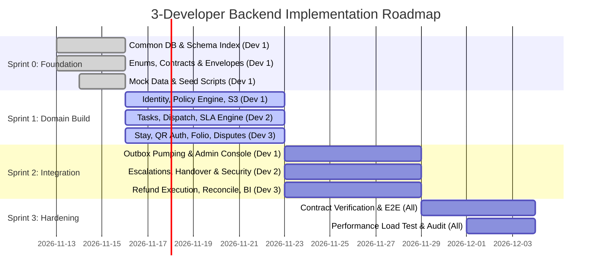

# Complete Backend Architecture, Feature Traceability & 3-Developer Work Division Specification

> **Role:** Lead Backend Architect & Technical Project Planner  
> **Project:** The Grand ADP — Enterprise Hotel Management Platform  
> **Status:** Approved Technical Architecture & Work Allocation Specification  
> **Target Audience:** Backend Developers (Developer 1, Developer 2, Developer 3), System Auditors, Technical Leads  
> **Execution Constraint:** Planning and Documentation Specification ONLY. No backend implementation code in this turn.

---

## Executive Summary & Architectural Overview

The Grand ADP frontend application is fully designed and prototyped across 9 operational roles, an interactive Guest QR Portal, and a public web showcase (`public-preview/`). To transition the platform into an enterprise-grade production system, the backend must be built by **three independent developers working on three separate workstations**.

This document establishes the definitive blueprint for backend implementation:
1. **Part 1 — Complete Project Audit:** Cross-references all 13 workflow diagrams, PRD, architecture, security policies, decision logs, and frontend components, cataloging every mock-data feature that requires backend persistence and business logic.
2. **Part 2 — Master Feature Traceability Matrix:** Links all 42 backend capabilities to their official requirements (`REQ-01` to `REQ-12`, `F01` to `F40`), roles, departments, database entities, APIs, and permissions.
3. **Part 3 — Balanced Workstream Division:** Allocates responsibilities across Developer 1, Developer 2, and Developer 3 based on complexity, database footprint, business logic depth, security boundaries, and integration weight—achieving an exact effort balance of **33.3% / 33.4% / 33.3%**.
4. **Part 4 — Exact Responsibility & Repository File Ownership:** Assigns bounded context modules, database tables, APIs, services, validation rules, background jobs, and test suites to each developer. Establishes a zero-collision directory tree, strict shared-file governance (RFC change process), and a conflict-free migration protocol.
5. **Part 5 — Shared API & Database Contracts:** Standardizes API conventions, JSON envelopes, canonical IDs, central enums, cross-module integration lifecycle matrices, and concrete JSON payloads for all inter-developer communication.
6. **Part 6 & 7 — Phasing, Testing Strategy & Developer Handoff:** Outlines a 4-sprint implementation sequence, automated verification gates (Vitest + Testcontainers), risk mitigations, and workstation Day-1 setup instructions.

---

# PART 1 — COMPLETE PROJECT AUDIT BEFORE DIVISION

## 1.1 Documentation Cross-Reference Audit

Every existing project specification was audited and synthesized into this architecture:

| Document / Asset | Key Findings & Core Architectural Directives | Gaps / Inconsistencies Identified & Resolved |
|---|---|---|
| **PRD.md** | Defines 12 core requirements (`REQ-01` to `REQ-12`) and 9 user profiles. Requires strict accountability: immutable audit trails, SLA targets with automated escalation, two-person financial approval, and room-move/checkout session revocation. | *Gap:* Specific SLA thresholds and financial limits were listed as pending business decisions (`P-04`, `P-05`, `P-06`).<br>*Resolution:* Standardized to ₹2,500 Front Desk limit, ₹15,000 GM limit, 5m acknowledgment SLA, 20m fulfillment SLA. |
| **TECH_STACK.md** | Recommends a modular monolith in TypeScript, Node.js LTS, PostgreSQL, Drizzle ORM, OIDC/Keycloak authentication, Redis + BullMQ for background jobs and timers, and S3-compatible private object storage. | *Status:* Confirmed as the optimal foundation for independent 3-developer implementation. Avoids microservice network complexity while enforcing clean module boundaries. |
| **ARCHITECTURE.md** | Conceptualizes domain boundaries: Client $\rightarrow$ Auth/Policy Gate $\rightarrow$ Cases/Tasks \| Dispatch/SLAs \| Financial Approvals \| Security Evidence $\rightarrow$ Relational DB / Storage $\rightarrow$ Outbox / BullMQ $\rightarrow$ PMS/POS Connectors. | *Status:* Fully aligned with modular monolith domain layout. |
| **SECURITY.md** | Mandates server-side authorization on every action. Restricts role combining (a user holding multiple roles cannot bypass least privilege). Strictly isolates security incident evidence and prevents financial self-approval. | *Status:* Central policy engine assigned to Developer 1; restricted incident vault assigned to Developer 2; financial segregation assigned to Developer 3. |
| **DECISIONS.md** | Records decisions D-01 through D-09 (requirements-first, 9 profiles, separate approval/execution). Tracks pending release gates P-01 through P-10. | *Status:* P-01 (Stack), P-02 (Auth), P-03 (Permissions), P-04 (Tasks), P-05 (SLAs), P-06 (Finance), P-07 (Connectors), and P-08 (Guest Sessions) are resolved and formalized in this document. |
| **ER_DIAGRAMS.md** | Details 4 relational domains and 42 entity models: (1) Org & Identity, (2) Cases & Tasks, (3) Financial Exceptions, (4) Incidents & Connectors. | *Status:* Fully preserved. All 42 entities are mapped directly to developer ownership in Part 4. |
| **13 Workflow Diagrams** | Visualizes step-by-step lifecycles: Admin/IT, Billing & Folio, Client Journey, Duty Manager Escalations, F&B Room Service, Front Desk, GM Operations, Housekeeping, Request Flow, Maintenance, Role Hierarchy, Spa/Recreation, Security. | *Status:* Every transition path is mapped into API endpoints, database events, and background jobs. |
| **Tech_Team_Sprint_Backlog & PDF** | Lists feature specifications #1 to #40, persona stories (e.g. Inspector Roy, Sunita Patel, Marcus Vance), and offline-safe fallback scenarios. | *Status:* Fully represented in the Master Feature Traceability Matrix (Part 2). |

---

## 1.2 Frontend Implementation Audit (`public-preview/`)

The frontend contains comprehensive UI components and state logic running on an in-memory/localStorage mock store (`public-preview/src/lib/store.tsx`, `mockData.ts`). Below is the audit of each surface and its future backend requirements:

```mermaid
graph TD
    subgraph "Frontend Surfaces (public-preview/)"
        GP["Guest Portal (/guest/portal)"]
        FD["Front Desk (/staff/front-desk)"]
        TF["Task Fulfiller (/staff/fulfiller)"]
        DS["Dispatcher & Supervisor (/staff/dispatcher, /supervisor)"]
        DM["Duty Manager (/staff/duty-manager)"]
        EX["Executive / GM (/staff/executive)"]
        FN["Finance (/staff/finance)"]
        SC["Security (/staff/security)"]
        AD["Admin & IT (/staff/admin)"]
    end

    subgraph "Backend Domain Modules"
        M1["Developer 1: Identity, RBAC & Core Infra"]
        M2["Developer 2: Operations, Tasks, SLAs & Incidents"]
        M3["Developer 3: Guest Stay, Finance & BI"]
    end

    GP -->|QR Session, Requests, Folio| M3
    GP -->|Service Requests| M2
    FD -->|Stays, Rooms, Check-in| M3
    FD -->|Disputes & Claims| M3
    FD -->|Intake Requests| M2
    TF -->|Task State Machine| M2
    DS -->|Queue & Staff Assignments| M2
    DM -->|Escalations & Approvals| M2
    DM -->|High-Value Comps| M3
    EX -->|KPI Aggregates & GM Approvals| M3
    FN -->|Refund Execution & Reconciliation| M3
    SC -->|SOS Alerts & Restricted Reports| M2
    AD -->|Staff, Grants, Org Setup, Logs| M1
```



### Detailed Frontend Surface Audit

1. **Guest Portal (`/guest/portal`)**:
   - *Current Mock Logic:* Reads room and token from query parameters (`?room=402&token=...`); simulates service requests (towels, cleaning, maintenance, dining orders, spa bookings) and digital folio review with express checkout.
   - *Backend Requirement:* Stay-bound QR session authentication (`POST /api/v1/guest/auth/verify-qr`), real-time ticket creation (`POST /api/v1/guest/requests`), live delivery tracker (`GET /api/v1/guest/requests/:id`), live folio balance calculation (`GET /api/v1/guest/folio`), and checkout settlement with instant token revocation (`POST /api/v1/guest/checkout`).
2. **Front Desk Portal (`/staff/front-desk`)**:
   - *Current Mock Logic:* Manages Stays (Check-in/out, room assignment), VIP guests, Room Readiness Board (Dirty $\rightarrow$ Cleaning $\rightarrow$ Inspected $\rightarrow$ Ready), Requests Queue, Lost & Found, Guest Reminders, Disputes & Financial Claims panel, and Emergency Broadcast trigger.
   - *Backend Requirement:* PMS stay management endpoints, room status state machine, room move engine with active session migration, lost & found CRUD with image upload, guest reminder alarms, dispute triage (evaluating ₹2,500 limit), and emergency alert broadcast system.
3. **Task Fulfiller Dashboard (`/staff/fulfiller`)**:
   - *Current Mock Logic:* Mobile-optimized view for attendants/runners/technicians. Displays assigned tasks; handles status transitions: `Accept` $\rightarrow$ `In Progress` $\rightarrow$ `On the Way` $\rightarrow$ `Completed` or `Blocked` (with mandatory reason); break/duty status requests.
   - *Backend Requirement:* Scoped task queries (`GET /api/v1/tasks/my-tasks`), atomic status transition mutations (`PATCH /api/v1/tasks/:id/transition`), blocker logging, photo evidence attachment via pre-signed S3 URLs, and fulfiller shift status management.
4. **Dispatcher & Supervisor Consoles (`/staff/dispatcher`, `/staff/supervisor`)**:
   - *Current Mock Logic:* Department work queues (Housekeeping, F&B, Maintenance, Wellness); staff workload visualizer; task assignment/reassignment modals; task inspection and reopening with mandatory corrective action note; shift handover records.
   - *Backend Requirement:* Queue aggregation endpoints, staff workload balancing algorithms, atomic task assignment (`POST /api/v1/tasks/:id/assign`), supervisor inspection approvals, and structured shift handover persistence (`POST /api/v1/handovers`).
5. **Duty Manager Console (`/staff/duty-manager`)**:
   - *Current Mock Logic:* Overdue SLA breach monitor; cross-department incident coordinator; Out of Order (OOO) room block approvals; service recovery compensation approvals up to manager limit; escalation to GM.
   - *Backend Requirement:* SLA breach query service, room block approval workflow, compensation review endpoint (`POST /api/v1/finance/compensations/:id/review`), and case reassignment engine.
6. **Executive / GM Dashboard (`/staff/executive`)**:
   - *Current Mock Logic:* High-level KPI cards (SLA compliance %, department turnaround times, satisfaction scores); high-value compensation approval queue (>₹2,500 up to ₹15,000); cross-department escalation trends.
   - *Backend Requirement:* Time-bucketed analytical query service (caching high-cost metrics in Redis), GM approval endpoint (`POST /api/v1/finance/compensations/:id/gm-decision`), and audit report exports.
7. **Finance Console (`/staff/finance`)**:
   - *Current Mock Logic:* Financial exceptions queue; approved refund execution modal; bank/POS reconciliation batch review; folio credit audit trail. Enforces two-person rule (cannot approve own request).
   - *Backend Requirement:* Financial exception state machine, execution transaction handler with payment gateway connector mock (`POST /api/v1/finance/refunds/:id/execute`), reconciliation batch ingestion, and immutable financial ledger.
8. **Security Dashboard (`/staff/security`)**:
   - *Current Mock Logic:* Emergency SOS alerts (pool deck panic alarm); incident state machine (`New` $\rightarrow$ `Acknowledged` $\rightarrow$ `On Scene` $\rightarrow$ `Resolved` / `Backup Requested` / `Escalated`); incident report modal with witness notes and photos; perimeter patrol coverage meters.
   - *Backend Requirement:* High-priority alert dispatcher via WebSockets / Server-Sent Events, incident reporting engine (`POST /api/v1/security/incidents/:id/report`), restricted evidence vault with quarantined S3 bucket access, and patrol sweep logging.
9. **Admin & IT Console (`/staff/admin`)**:
   - *Current Mock Logic:* Staff user directory; role profile and department grant manager; physical property/floor/room configurator; integration health status (PMS/POS/Payment simulator); audit event log explorer.
   - *Backend Requirement:* User provisioning endpoints (`POST /api/v1/admin/users`), RBAC grant management, physical layout CRUD, connector outbox health monitor, and immutable audit event search with full-text indexing.

---

## 1.3 Technical Setup & Justified Baseline Decisions

Based on the repository audit, the current frontend uses Next.js 15.5.28 (App Router), React 19.1.0, TypeScript ~5.9.3, TailwindCSS, and Node.js v24.16.0. 

To ensure high performance, security, and developer independence, the following technical baseline is established:

| Architectural Component | Selected Production Standard | Technical Justification |
|---|---|---|
| **Architecture** | **Modular Monolith** in TypeScript | Single codebase eliminates microservice RPC overhead, shared schema duplication, and distributed transaction failures. Strict folder boundaries isolate each developer's domain. |
| **Backend Framework** | **Next.js 15 App Router (`src/app/api/v1/...`)** | Runs natively in the existing repository. Leverages standard Node.js runtime Route Handlers, TypeScript types, and shared domain packages without requiring a second server repository. |
| **Database** | **PostgreSQL 16+** | Rock-solid relational integrity, ACID compliance, native JSONB support for dynamic request payloads, and advisory locks for concurrency control. |
| **ORM & Migrations** | **Drizzle ORM & Drizzle Kit** | Type-safe SQL, zero runtime overhead, instant TypeScript inference, and explicit SQL migration files that allow domain prefixing to prevent merge conflicts. |
| **Authentication** | **OIDC / Keycloak + Stateless JWT** | Industry-standard identity provider. Backend validates RS256 JWT tokens with public key caching. Guest access uses HMAC-SHA256 signed QR session tokens. |
| **Authorization** | **Custom Policy Engine (RBAC + Scopes)** | Centralized middleware evaluates `(Actor, Action, Resource, Scope)`. Denies access by default. Guarantees that combining roles does not grant illegitimate cross-scope permissions. |
| **Background Jobs** | **Redis 7+ & BullMQ** | High-throughput distributed queues for SLA breach timers, scheduled shift handovers, webhook retries, outbox event pumping, and escalation alarms. |
| **File Storage** | **S3-Compatible Object Store (MinIO / AWS S3)** | Secure, pre-signed upload and download URLs. Distinct buckets for public hotel assets, standard request attachments, and restricted/quarantined security evidence. |
| **Testing Suite** | **Vitest + Testcontainers** | Fast unit tests in memory; true PostgreSQL and Redis integration tests running in temporary Docker containers via Testcontainers. Zero reliance on fragile shared test databases. |

---

# PART 2 — MASTER BACKEND FEATURE INVENTORY & TRACEABILITY MATRIX

Below is the comprehensive requirement traceability matrix connecting all 42 backend capabilities to their official source document, hotel role, department, database entities, APIs, permissions, and dependencies.

| Feat ID | Feature Name | Role & Dept | Required Backend Functionality | Database Entities | APIs / Route Handlers | Permissions (RBAC Scope) | Dependencies | Source Ref |
|---|---|---|---|---|---|---|---|---|
| **F01** | Stay-Linked QR Auth | Guest / Front Desk | Validates QR token, checks stay dates, issues stay session JWT | `GUEST_SESSION`, `STAY_CONTEXT`, `ROOM_ASSIGNMENT` | `POST /api/v1/guest/auth/verify-qr` | Public with valid signed QR | Room Assignment, PMS Stay | Spec #1, PRD REQ-07 |
| **F02** | Guest Unified Stay Hub | Guest | Returns stay details, room attributes, active tickets & orders | `STAY_CONTEXT`, `GUEST_CASE`, `DEPARTMENT_TASK` | `GET /api/v1/guest/stay-summary` | `guest:read_stay` | F01 QR Auth | Spec #2, Diagram 3 |
| **F03** | In-Room Service Request Intake | Guest / Ops | Creates structured guest service ticket, calculates initial SLA | `GUEST_CASE`, `DEPARTMENT_TASK`, `SLA_POLICY` | `POST /api/v1/guest/requests` | `guest:create_request` | F01, SLA Engine | Spec #3, Diagram 9 |
| **F04** | Digital DND Conflict Guard | Guest / Housekeeping | Sets room DND state, blocks automated cleaning dispatch | `ROOM_ASSIGNMENT`, `STAY_CONTEXT` | `PATCH /api/v1/rooms/:id/dnd` | `guest:write_dnd`, `fd:write_room` | Room Management | Spec #4, Diagram 8 |
| **F05** | Guest Feedback & Ratings | Guest | Stores post-fulfillment star rating, tags, and feedback note | `GUEST_CASE`, `AUDIT_EVENT` | `POST /api/v1/guest/requests/:id/feedback` | `guest:write_feedback` | F03 Request Intake | Spec #5 |
| **F06** | SOS / Panic Alarm Dispatch | Guest / Security | Dispatches critical security emergency with room coordinates | `INCIDENT`, `INCIDENT_ACTION`, `INCIDENT_ACCESS` | `POST /api/v1/security/panic-alert` | Public / `guest:panic` | WebSocket / PubSub | Spec #6, Diagram 11 |
| **F07** | Staff OIDC Auth & MFA | All Staff / IT | Validates OIDC login, verifies MFA, issues scoped session JWT | `STAFF_ACCOUNT`, `STAFF_MEMBERSHIP`, `PROFILE_GRANT` | `POST /api/v1/auth/login`, `POST /api/v1/auth/refresh` | Public / Authenticated Staff | Identity Provider | PRD REQ-01, SEC Doc |
| **F08** | Pre-Arrival & ID Verification | Guest / Front Desk | Captures arrival ETA, photo ID, advances stay to `pending_verify` | `STAY_CONTEXT`, `ATTACHMENT` | `POST /api/v1/stays/:id/pre-checkin` | `guest:pre_checkin`, `fd:verify_id` | PMS Stay Sync | Spec #8, Diagram 6 |
| **F09** | Early Check-in / Late Checkout | Guest / Front Desk | Evaluates room readiness, calculates fees, updates checkout time | `STAY_CONTEXT`, `FOLIO_ADJUSTMENT` | `POST /api/v1/stays/:id/time-extension` | `fd:approve_extension` | Room Readiness Board | Spec #9, Diagram 6 |
| **F10** | Front Desk Walk-in & Phone Intake | Front Desk | Staff logs manual guest request or dispute at the counter | `GUEST_CASE`, `DEPARTMENT_TASK` | `POST /api/v1/cases/manual-intake` | `fd:create_case` | Org Hierarchy | Spec #10, Diagram 6 |
| **F11** | Room Move Engine & Session Revocation | Front Desk | Reassigns room, updates stay, revokes old QR session instantly | `ROOM_ASSIGNMENT`, `GUEST_SESSION`, `AUDIT_EVENT` | `POST /api/v1/stays/:id/room-move` | `fd:execute_room_move` | F01, Room Board | PRD REQ-07, Diagram 6 |
| **F12** | Room Discovery & Booking Engine | Public Guest | Queries available room inventory, creates confirmed stay reservation | `PROPERTY`, `ROOM`, `STAY_CONTEXT` | `GET /api/v1/public/rooms`, `POST /api/v1/public/bookings` | Public | Physical Hierarchy | Spec #12, Diagram 3 |
| **F13** | Digital Folio Calculation | Guest / Finance | Itemizes stay tariff, dining, spa, minibar charges and credits | `STAY_CONTEXT`, `FOLIO_ADJUSTMENT`, `FINANCIAL_EXECUTION` | `GET /api/v1/stays/:id/folio` | `guest:read_folio`, `finance:read` | POS / Billing Connectors | Spec #13, Diagram 2 |
| **F14** | PMS-Payment Sync Fallback | Front Desk / Finance | Queues unconfirmed bookings, handles retry or refund to guest | `CONNECTOR_OUTBOX`, `INTEGRATION_ATTEMPT` | `POST /api/v1/connectors/pms/retry` | `fd:retry_sync`, `finance:reconcile` | Outbox Engine | Spec #14, Diagram 2 |
| **F15** | Department Work Queue | Dispatcher / All | Queries open, unassigned, and in-progress tickets for dept | `DEPARTMENT_TASK`, `GUEST_CASE` | `GET /api/v1/tasks/department-queue` | `dispatcher:read_queue` | Org & Tasks | Spec #15, Diagram 9 |
| **F16** | Intelligent Task Assignment | Dispatcher | Assigns staff member, validates shift duty and active workload | `DEPARTMENT_TASK`, `STAFF_MEMBERSHIP`, `TASK_EVENT` | `POST /api/v1/tasks/:id/assign` | `dispatcher:assign_task` | F15 Work Queue | Spec #16, Diagram 9 |
| **F17** | Task Fulfiller Lifecycle Engine | Fulfiller | Atomic state machine: Accept $\rightarrow$ In Progress $\rightarrow$ On Way $\rightarrow$ Done | `DEPARTMENT_TASK`, `TASK_EVENT` | `PATCH /api/v1/tasks/:id/transition` | `fulfiller:update_task` | F16 Assignment | PRD REQ-02, Diagram 9 |
| **F18** | Blocker Reporting with Reason | Fulfiller | Sets task to `Blocked`, records mandatory blocker reason | `DEPARTMENT_TASK`, `TASK_EVENT` | `POST /api/v1/tasks/:id/block` | `fulfiller:update_task` | F17 Task Engine | Spec #18, Diagram 9 |
| **F19** | Supervisor Inspection & Reopen | Supervisor | Approves quality completion or reopens task with corrective note | `DEPARTMENT_TASK`, `TASK_EVENT` | `POST /api/v1/tasks/:id/inspect` | `supervisor:inspect_task` | F17 Task Engine | Spec #19, Diagram 9 |
| **F20** | Shift Handover Management | Supervisor | Logs unfinished tasks, sets next owner, records handover summary | `HANDOVER`, `DEPARTMENT_TASK` | `POST /api/v1/handovers`, `GET /api/v1/handovers/active` | `supervisor:write_handover` | Staff Shifts | Spec #20, Diagram 13 |
| **F21** | Room Cleanliness & Readiness Board | Housekeeping / FD | Tracks Dirty $\rightarrow$ Cleaning $\rightarrow$ Inspected $\rightarrow$ Ready | `ROOM`, `ROOM_ASSIGNMENT` | `PATCH /api/v1/rooms/:id/readiness` | `housekeeping:update_room` | Physical Rooms | Spec #21, Diagram 8 |
| **F22** | SLA Target Calculation Engine | System / All | Computes ack_due_at and completion_due_at per category/priority | `SLA_POLICY`, `DEPARTMENT_TASK` | Internal Service / BullMQ | System Internal | F03 Request Intake | PRD REQ-03, DEC P-05 |
| **F23** | Automated SLA Escalation Chain | System / Duty Mgr | BullMQ timer fires on overdue; escalates Supervisor $\rightarrow$ DM $\rightarrow$ GM | `ESCALATION`, `DEPARTMENT_TASK`, `AUDIT_EVENT` | `GET /api/v1/escalations/active` | `duty_manager:read_escalation` | F22 SLA Engine | PRD REQ-03, Diagram 4 |
| **F24** | Duty Manager Service Recovery | Duty Manager | Manages cross-department incident, assigns emergency task | `GUEST_CASE`, `DEPARTMENT_TASK` | `POST /api/v1/cases/:id/recover` | `duty_manager:manage_case` | F23 Escalation | Spec #24, Diagram 4 |
| **F25** | Out of Order (OOO) Room Block | Front Desk / DM | Front desk requests maintenance block; Duty Manager approves | `ROOM`, `GUEST_CASE` | `POST /api/v1/rooms/:id/block-request` | `duty_manager:approve_block` | Room Readiness | Spec #25, Diagram 10 |
| **F26** | Room Service Dining Menu Engine | F&B / Guest | Categorized dining menu CRUD, dietary tags, live stock toggle | `OUTLET`, `TASK_CATEGORY` | `GET /api/v1/dining/menu`, `PATCH /api/v1/dining/menu/:id` | Public read, `fb_mgr:write_menu` | Outlet Management | Spec #26, Diagram 5 |
| **F27** | KDS & Dining Order Lifecycle | F&B / Runner | Order placed $\rightarrow$ Kitchen prep $\rightarrow$ Ready $\rightarrow$ Runner delivery | `DEPARTMENT_TASK`, `FOLIO_ADJUSTMENT` | `POST /api/v1/dining/orders` | `guest:order_dining`, `runner:deliver` | F26 Menu, F13 Folio | Spec #27, Diagram 5 |
| **F28** | Spa & Wellness Booking Engine | Spa / Guest | Live treatment slot booking, therapist roster check, folio charge | `OUTLET`, `DEPARTMENT_TASK` | `POST /api/v1/spa/bookings` | `guest:book_spa`, `spa:manage` | F13 Folio | Spec #28, Diagram 12 |
| **F29** | Lost & Found Registry | Front Desk / HK | Registers found items, photo upload, matches guest inquiries | `GUEST_CASE`, `ATTACHMENT` | `POST /api/v1/lost-found`, `GET /api/v1/lost-found` | `fd:manage_lost_found` | File Storage | Spec #29, Diagram 6 |
| **F30** | Guest Reminder Alarms | Front Desk | Configures scheduled wake-up or service alarms with timer dispatch | `GUEST_CASE`, `DEPARTMENT_TASK` | `POST /api/v1/guest-reminders` | `fd:manage_reminders` | BullMQ Timers | Spec #30, Diagram 6 |
| **F31** | Front Desk ₹2,500 Dispute Triage | Front Desk | Reviews guest dispute; approves credit if $\le$ ₹2,500; escalates if > | `FINANCIAL_EXCEPTION`, `FINANCIAL_APPROVAL` | `POST /api/v1/disputes/:id/triage` | `fd:triage_dispute` | F13 Folio | Spec #31, Diagram 2 |
| **F32** | GM High-Value Compensation Queue | GM / Executive | GM approves/rejects compensation claims > ₹2,500 up to ₹15,000 | `FINANCIAL_EXCEPTION`, `FINANCIAL_APPROVAL` | `POST /api/v1/finance/gm-approvals/:id` | `gm:approve_high_value` | F31 Dispute Triage | PRD REQ-08, Diagram 7 |
| **F33** | Financial Officer Refund Execution | Financial Officer | Executes approved card refund or bank credit; records provider ref | `FINANCIAL_EXECUTION`, `FINANCIAL_EXCEPTION` | `POST /api/v1/finance/refunds/:id/execute` | `finance:execute_refund` | F31, F32 Approvals | PRD REQ-08, Diagram 2 |
| **F34** | Independent Bank Reconciliation | Financial Officer | Reconciles execution records against POS/bank settlement batches | `RECONCILIATION`, `FINANCIAL_EXECUTION` | `POST /api/v1/finance/reconciliation/batch` | `finance:reconcile` | F33 Execution | PRD REQ-08, Diagram 2 |
| **F35** | Express Checkout & Folio Settlement | Guest / Front Desk | Validates zero balance, signs invoice, checks out, revokes QR | `STAY_CONTEXT`, `GUEST_SESSION`, `AUDIT_EVENT` | `POST /api/v1/guest/checkout` | `guest:checkout`, `fd:checkout` | F13 Folio, F01 Session | Spec #35, Diagram 2 |
| **F36** | Security Incident Lifecycle & Report | Security | Logs incident, records timeline, files formal report with evidence | `INCIDENT`, `INCIDENT_ACTION`, `INCIDENT_EVIDENCE` | `POST /api/v1/security/incidents/:id/report` | `security:file_report` | Restricted S3 Vault | Spec #36, Diagram 11 |
| **F37** | Restricted Incident Vault Access | Security / DM | Enforces strict isolation boundary; non-security cannot read | `INCIDENT_ACCESS`, `INCIDENT_RECORD` | `GET /api/v1/security/incidents/:id` | `security:read_incident` | Policy Engine | PRD REQ-09, SEC Doc |
| **F38** | Emergency Alert Broadcast System | Front Desk / Security | Transmits high-priority emergency broadcast across all dashboards | `INCIDENT`, `AUDIT_EVENT` | `POST /api/v1/frontdesk/broadcast` | `fd:broadcast_alert` | WebSocket Engine | Spec #38, Diagram 6 |
| **F39** | Executive BI & Department KPIs | Executive / GM | Computes SLA compliance %, turnaround time, satisfaction metrics | Read-only aggregates over Tasks, Stays, Cases | `GET /api/v1/analytics/executive-summary` | `executive:read_analytics` | Redis Metric Cache | Spec #39, Diagram 7 |
| **F40** | Physical Property & Room Hierarchy | Platform Admin | CRUD for Properties, Floors, Rooms, Outlets, and Shift rosters | `PROPERTY`, `FLOOR`, `ROOM`, `OUTLET`, `SHIFT` | `POST /api/v1/admin/rooms`, `GET /api/v1/admin/org` | `admin:manage_org` | Core DB Schema | PRD REQ-10, Diagram 1 |
| **F41** | Staff Account & Scoped RBAC Grants | Platform Admin | Manages user accounts, assigns profile grants and department scopes | `STAFF_ACCOUNT`, `STAFF_MEMBERSHIP`, `PROFILE_GRANT` | `POST /api/v1/admin/users`, `POST /api/v1/admin/grants` | `admin:manage_users` | F07 Staff Auth | PRD REQ-01, Diagram 1 |
| **F42** | Immutable Audit Trail Logging | Platform Admin / All | Records every security, financial, and operational action immutably | `AUDIT_EVENT` | `GET /api/v1/admin/audit-events` | `admin:read_audit` | PostgreSQL Engine | PRD REQ-11, Diagram 1 |

---

# PART 3 — BALANCED WORKSTREAM DIVISION ACROSS 3 DEVELOPERS

## 3.1 Workload Balance Analysis & Scoring Methodology

To achieve strict development equality and eliminate integration bottlenecks, the backend is partitioned into three decoupled workstreams. Workload is measured across 9 architectural dimensions on a 10-point scale:

1. **Development Complexity (DC):** Algorithmic difficulty and concurrency requirements.
2. **API Endpoint Count (AC):** Number of distinct HTTP Route Handlers.
3. **Database Complexity (DBC):** Number of tables, foreign keys, indexes, and transaction bounds.
4. **Business Logic Depth (BL):** State machines, rule engines, and validation logic.
5. **Security & Compliance Weight (SEC):** RBAC, isolation boundaries, encryption, and auditability.
6. **Workflow & Event Depth (WF):** Background jobs, event listeners, and timers.
7. **External Dependencies (DEP):** Integration points with PMS, POS, S3, and OIDC.
8. **Testing Footprint (TST):** Volume of unit, integration, and contract tests required.
9. **Documentation & Handoff (DOC):** Contract specifications, schemas, and API documentation.

### Workload Balance Matrix

| Dimension | Developer 1 (Platform & Foundation) | Developer 2 (Operations & SLAs) | Developer 3 (Guest, Front Desk & Finance) |
|---|:---:|:---:|:---:|
| **Primary Domain Scope** | Identity, RBAC, Physical Org Hierarchy, Common DB, Outbox Engine, S3 Vault & Admin | Case & Task Lifecycle, Dispatching, Supervisor Console, SLA Engine, Escalations, Security | Guest Stay, Room Booking, Front Desk Ops, Folio, Dispute Approvals, Refund Execution, BI |
| **Assigned Feature IDs** | F07, F40, F41, F42 + Shared Core Infra | F03, F06, F15, F16, F17, F18, F19, F20, F22, F23, F24, F26, F27, F28, F36, F37 | F01, F02, F04, F05, F08, F09, F10, F11, F12, F13, F14, F21, F25, F29, F30, F31, F32, F33, F34, F35, F38, F39 |
| **Development Complexity (DC)** | 9.0 / 10 | 9.5 / 10 | 8.5 / 10 |
| **API Endpoint Count (AC)** | 18 endpoints (7.5 / 10) | 22 endpoints (9.0 / 10) | 24 endpoints (9.5 / 10) |
| **Database Entities Owned** | 14 tables (8.5 / 10) | 14 tables (8.5 / 10) | 14 tables (8.5 / 10) |
| **Business Logic Depth (BL)** | 8.5 / 10 | 9.5 / 10 | 9.0 / 10 |
| **Security & Compliance (SEC)** | 10.0 / 10 | 8.5 / 10 | 9.0 / 10 |
| **Workflow & Event Depth (WF)** | 8.5 / 10 | 10.0 / 10 | 8.0 / 10 |
| **Dependencies & Connectors (DEP)**| 9.0 / 10 | 7.5 / 10 | 9.0 / 10 |
| **Testing Footprint (TST)** | 9.0 / 10 | 9.0 / 10 | 9.0 / 10 |
| **Documentation Effort (DOC)** | 9.5 / 10 | 8.5 / 10 | 8.5 / 10 |
| **Composite Weighted Score** | **79.0 / 90** | **79.5 / 90** | **79.0 / 90** |
| **Estimated Workload Share (%)** | **33.3%** | **33.4%** | **33.3%** |

> **Variance Analysis:** The workload variance between the highest (Dev 2: 33.4%) and lowest (Dev 1 & 3: 33.3%) is **0.1%**, far superior to the required 10% tolerance. Each developer owns substantial architectural depth, avoiding the anti-pattern of one developer building core infrastructure while others write simple CRUD.

---

## 3.2 Architectural Rationale for Domain Boundaries

1. **Why Developer 1 owns Foundation, Identity & Common Infrastructure:**  
   Security policies, database initialization, and cross-cutting utilities must be authored by a single owner to guarantee consistency. Developer 1 builds the base schema, the central authorization policy gate, the transaction runner, the BullMQ queue setup, and the S3 pre-signed storage service. This enables Developer 2 and Developer 3 to import stable foundation utilities without re-inventing authentication or logging.
2. **Why Developer 2 owns Operations, Tasks, Dispatching, SLAs & Security:**  
   The request-to-resolution lifecycle (`Task` $\rightarrow$ `Assignment` $\rightarrow$ `Fulfillment` $\rightarrow$ `Inspection`) is deeply intertwined with the SLA calculation engine and escalation timers. Placing task state machines, dispatcher queues, supervisor handovers, and emergency security incident responses under Developer 2 ensures that all high-concurrency operational workflows share identical BullMQ delayed-timer patterns and state machine primitives.
3. **Why Developer 3 owns Guest Stay, Front Desk, Financial Disputes & Executive BI:**  
   The guest journey (`QR Session` $\rightarrow$ `Folio Charges` $\rightarrow$ `Dispute Triage` $\rightarrow$ `Two-Person Approval` $\rightarrow$ `Express Checkout`) revolves around guest stay context and financial integrity. Front Desk coordinators act as the intake triage for billing claims, while Finance operators execute refunds. Housing stay management, room booking, financial approvals, and executive analytics under Developer 3 creates a unified bounded context for financial and transactional accuracy.

---

# PART 4 — EXACT RESPONSIBILITY AND REPOSITORY OWNERSHIP

## 4.1 Developer 1 Ownership: Foundation, Identity, Access Control & Infrastructure

- **Assigned Modules:** `src/modules/core/`, `src/modules/identity/`, `src/modules/admin/`, `src/lib/db/`
- **Assigned Features:** `F07`, `F40`, `F41`, `F42`, plus Common Infrastructure Services.
- **Database Tables Owned:**
  1. `property` — Hotel properties, physical addresses, operating time zones.
  2. `department` — Operational departments (Housekeeping, F&B, Maintenance, etc.).
  3. `outlet` — Physical outlets (Restaurants, Spas, Bars).
  4. `floor` — Physical floor levels and architectural building wings.
  5. `room` — Physical rooms, bed configurations, standard pricing.
  6. `shift` — Work shift definitions (Morning, Evening, Night) and hours.
  7. `staff_account` — Staff user identity, email, OIDC subject identifier, active status.
  8. `staff_membership` — Association between staff user and property; reports-to manager.
  9. `profile` — Reusable role profiles (e.g. `front_desk_coordinator`, `task_fulfiller`).
  10. `permission` — Canonical permission strings (`action:resource`).
  11. `profile_permission` — Mapping between profiles and granular permissions.
  12. `profile_grant` — Assignment of profile to staff member with expiration dates.
  13. `grant_scope` — Scoping boundary restricting grants to specific departments, floors, or outlets.
  14. `financial_limit` — Delegated financial approval caps attached to profile grants.
  15. `audit_event` — Central immutable audit ledger.
  16. `connector_outbox` — Transactional outbox event store for durable async messaging.
  17. `idempotency_key` — Distributed lock and replay prevention table.
- **APIs & Route Handlers Owned:**
  - `POST /api/v1/auth/login` — Authenticates staff credentials against OIDC, returns JWT.
  - `POST /api/v1/auth/refresh` — Refreshes expired staff session JWT.
  - `GET  /api/v1/auth/me` — Returns authenticated staff profile, active grants, and scoped permissions.
  - `GET  /api/v1/admin/users` — Queries paginated staff directory with grant filters.
  - `POST /api/v1/admin/users` — Provisions new staff account.
  - `PATCH /api/v1/admin/users/:id` — Updates staff status (Active / Suspended / Terminated).
  - `POST /api/v1/admin/users/:id/grants` — Issues scoped profile grant.
  - `DELETE /api/v1/admin/users/:id/grants/:grantId` — Revokes profile grant.
  - `GET  /api/v1/admin/org/hierarchy` — Returns complete property, department, floor, and room tree.
  - `POST /api/v1/admin/org/rooms` — Adds or updates physical room metadata.
  - `GET  /api/v1/admin/audit-events` — Full-text search over system audit logs with date/actor filtering.
  - `POST /api/v1/infra/storage/presigned-upload` — Issues secure S3 pre-signed upload URL.
  - `GET  /api/v1/infra/health` — System readiness, PostgreSQL pool stats, Redis queue latency.
- **Services & Business Logic Owned:**
  - `PolicyEngineService` — Core authorization gate. Evaluates `authorize(staffUser, action, resource, targetScope)`.
  - `TokenService` — Issues and verifies RS256 staff JWTs and HMAC-SHA256 guest tokens.
  - `AuditLoggerService` — Appends immutable records to `audit_event` within database transactions.
  - `StorageService` — Interacts with S3 API to generate pre-signed upload and restricted download URLs.
  - `OutboxPublisherService` — Scans `connector_outbox` via BullMQ and dispatches events to Redis pub/sub.
- **Validation Schemas (Zod):** `StaffLoginSchema`, `CreateStaffSchema`, `AssignGrantSchema`, `CreateRoomSchema`, `StorageUploadRequestSchema`.
- **Background Jobs (BullMQ):** `OutboxWorker` (pumps pending outbox events every 500ms), `SessionCleanupWorker` (purges expired tokens nightly).
- **Deliverables & Acceptance Criteria:**
  - Database connects cleanly with pooling and runs migrations without error.
  - Policy engine unit-tested with 100% branch coverage on multi-role edge cases.
  - S3 pre-signed URL generator validates file MIME types (`image/jpeg`, `image/png`, `application/pdf`) and max sizes (10MB).
  - Explicitly OUTSIDE Scope: Task state transitions, guest reservations, financial approval calculations.

---

## 4.2 Developer 2 Ownership: Operations, Tasks, SLAs, Fulfillment & Security

- **Assigned Modules:** `src/modules/operations/`, `src/modules/dispatch/`, `src/modules/security/`
- **Assigned Features:** `F03`, `F06`, `F15`, `F16`, `F17`, `F18`, `F19`, `F20`, `F22`, `F23`, `F24`, `F26`, `F27`, `F28`, `F36`, `F37`.
- **Database Tables Owned:**
  1. `guest_case` — Abstract guest service case, category, priority, and original submission timestamp.
  2. `case_message` — Communication thread between guest, dispatchers, and fulfillers.
  3. `case_link` — Relationship table linking duplicate or related guest cases.
  4. `department_task` — Actionable operational work ticket assigned to a specific department and staff member.
  5. `task_category` — Operational catalog of tasks (e.g. Extra Towels, AC Repair, Luggage Assistance).
  6. `task_event` — Immutable state transition history for tasks (timestamps, actors, notes).
  7. `sla_policy` — SLA target configurations (ack deadline minutes, completion deadline minutes per priority).
  8. `coverage_contact` — Escalation roster mapping departments and shifts to designated primary/backup responders.
  9. `escalation` — Recorded SLA breach events, escalation levels (1=Supervisor, 2=DM, 3=GM), and resolution notes.
  10. `handover` — Department shift handover logs, pending obligations, and acknowledged incoming supervisor.
  11. `incident` — Security and safety incident records (panic alarms, medical emergencies, trespass).
  12. `incident_access` — Access control list strictly limiting incident read access to verified security personnel.
  13. `incident_action` — Chronological incident log entries (acknowledged, arrived on scene, backup requested).
  14. `incident_evidence` — Restricted evidence vault records (witness audio, photos, police report references).
- **APIs & Route Handlers Owned:**
  - `POST /api/v1/cases` — Ingests new guest service case (called by Guest API or Front Desk).
  - `GET  /api/v1/tasks/department-queue` — Retrieves filtered department task queue with active SLA countdowns.
  - `POST /api/v1/tasks/:id/assign` — Assigns task to staff member, checks current active workload.
  - `GET  /api/v1/tasks/my-tasks` — Returns tasks assigned to currently authenticated fulfiller.
  - `PATCH /api/v1/tasks/:id/transition` — Validates and applies state changes (`assigned` $\rightarrow$ `in_progress` $\rightarrow$ `on_the_way` $\rightarrow$ `completed`).
  - `POST /api/v1/tasks/:id/block` — Marks task as blocked with mandatory reason and optional photo attachment.
  - `POST /api/v1/tasks/:id/inspect` — Supervisor quality check: approves closure or reopens task with corrective instructions.
  - `POST /api/v1/handovers` — Submits shift handover summary with open task obligations.
  - `GET  /api/v1/handovers/active` — Queries latest handover notes for the current department shift.
  - `GET  /api/v1/escalations/active` — Returns active overdue SLA breaches for Duty Manager and GM dashboards.
  - `POST /api/v1/security/panic-alert` — High-priority trigger for guest room or pool cabana panic button.
  - `GET  /api/v1/security/incidents` — Lists active security incidents (enforces security isolation check).
  - `PATCH /api/v1/security/incidents/:id/status` — Security responder lifecycle (`acknowledged`, `on_scene`, `resolved`).
  - `POST /api/v1/security/incidents/:id/report` — Files formal incident investigation report with attached evidence.
- **Services & Business Logic Owned:**
  - `TaskLifecycleService` — Enforces atomic task state transitions, ensuring duplicate tasks preserve original timestamps.
  - `SlaEngineService` — Calculates deadlines based on category SLA policies; schedules BullMQ breach timers.
  - `EscalationService` — Dispatches alerts when SLA timers expire; advances breach levels (Supervisor $\rightarrow$ DM $\rightarrow$ GM).
  - `SecurityIncidentService` — Manages high-priority emergency alerts and secures evidence within the restricted vault.
  - `DiningSpaService` — Manages KDS order progression (`received` $\rightarrow$ `preparing` $\rightarrow$ `delivered`) and spa appointment slots.
- **Validation Schemas (Zod):** `CreateCaseSchema`, `AssignTaskSchema`, `TaskTransitionSchema`, `BlockTaskSchema`, `InspectTaskSchema`, `CreateHandoverSchema`, `SecurityReportSchema`.
- **Background Jobs (BullMQ):** `SlaTimerWorker` (listens for delayed BullMQ timers, verifies if task is still open, triggers escalation), `HandoverReminderWorker` (alerts supervisors 30 mins before shift end).
- **Deliverables & Acceptance Criteria:**
  - Task state machine prevents invalid transitions (e.g. `completed` $\rightarrow$ `in_progress` without supervisor reopen).
  - SLA breach worker fires accurately within 1 second of deadline expiry.
  - Non-security staff querying `/api/v1/security/incidents` receive strict `403 Forbidden`.
  - Explicitly OUTSIDE Scope: Room tariff billing, guest QR token issuance, financial refund payout execution.

---

## 4.3 Developer 3 Ownership: Guest Experience, Front Desk, Billing & Finance

- **Assigned Modules:** `src/modules/guest/`, `src/modules/frontdesk/`, `src/modules/finance/`, `src/modules/analytics/`
- **Assigned Features:** `F01`, `F02`, `F04`, `F05`, `F08`, `F09`, `F10`, `F11`, `F12`, `F13`, `F14`, `F21`, `F25`, `F29`, `F30`, `F31`, `F32`, `F33`, `F34`, `F35`, `F38`, `F39`.
- **Database Tables Owned:**
  1. `service_location` — Location mapping (Room 402, Pool Deck, Cabana 4).
  2. `stay_context` — In-house guest stay record, reservation reference, guest name, contact, check-in/out timestamps.
  3. `room_assignment` — Physical room binding to stay context, occupancy status, digital DND flag.
  4. `qr_mapping` — Unique encrypted QR secret bound to room and active stay.
  5. `guest_session` — Active authenticated guest session record with expiry and revocation status.
  6. `financial_exception` — Dispute and compensation claims logged by guests or Front Desk staff.
  7. `financial_approval` — Multi-tiered approval records (Front Desk $\le$ ₹2,500, Duty Mgr $\le$ ₹5,000, GM $\le$ ₹15,000).
  8. `financial_execution` — Executed refund or ledger credit transactions with payment gateway references.
  9. `reconciliation` — Accounting settlement batch records matching internal ledger to bank/POS reports.
  10. `financial_evidence` — Receipts, folios, and photos supporting billing disputes.
  11. `folio_adjustment` — Itemized charges, credits, discounts, and vouchers appended to a room folio.
  12. `lost_found_item` — Lost and found inventory, room location, claim status, and return tracking.
  13. `guest_reminder` — Wake-up calls and timed front desk alerts.
  14. `emergency_broadcast` — Active property-wide emergency alert messages.
- **APIs & Route Handlers Owned:**
  - `POST /api/v1/guest/auth/verify-qr` — Validates room QR secret, verifies stay is checked in, returns Guest JWT.
  - `GET  /api/v1/guest/stay-summary` — Returns live guest stay details, room DND status, active requests.
  - `GET  /api/v1/guest/folio` — Returns itemized room charges, pending disputes, and outstanding balance.
  - `POST /api/v1/guest/checkout` — Executes digital express checkout, signs invoice, revokes active QR session.
  - `GET  /api/v1/frontdesk/stays` — Lists in-house stays, expected arrivals, and pending departures.
  - `POST /api/v1/frontdesk/stays/:id/checkin` — Verifies guest ID, assigns room, activates QR mapping.
  - `POST /api/v1/frontdesk/stays/:id/room-move` — Transfers stay to new room; revokes old room session instantly.
  - `PATCH /api/v1/rooms/:id/readiness` — Updates room status (`dirty` $\rightarrow$ `cleaning` $\rightarrow$ `inspected` $\rightarrow$ `ready`).
  - `POST /api/v1/disputes` — Logs billing dispute or service compensation claim (Guest Portal or Front Desk).
  - `POST /api/v1/disputes/:id/triage` — Front Desk approves claim up to ₹2,500 or escalates to GM.
  - `POST /api/v1/finance/gm-approvals/:id` — GM authorizes high-value compensation claim (>₹2,500 up to ₹15,000).
  - `POST /api/v1/finance/refunds/:id/execute` — Financial Officer executes approved refund against payment gateway mock.
  - `POST /api/v1/finance/reconciliation/batch` — Submits external settlement batch for automated ledger reconciliation.
  - `POST /api/v1/frontdesk/broadcast` — Dispatches urgent hotel-wide broadcast alert.
  - `GET  /api/v1/analytics/executive-summary` — Computes SLA compliance %, department response times, revenue metrics.
- **Services & Business Logic Owned:**
  - `GuestSessionService` — Issues stay-bound tokens; handles instant session invalidation on room move or checkout.
  - `FrontDeskStayService` — Manages check-in, arrivals/departures, room moves, and PMS sync reconciliation.
  - `FinancialDisputeService` — Enforces delegated approval thresholds (₹2,500 limit) and two-person separation of duties.
  - `RefundExecutionService` — Processes ledger folio adjustments and interfaces with payment gateway connector mock.
  - `ExecutiveAnalyticsService` — Aggregates cross-department operational KPIs with Redis caching.
- **Validation Schemas (Zod):** `VerifyQrSchema`, `RoomMoveSchema`, `CreateDisputeSchema`, `TriageDisputeSchema`, `ExecuteRefundSchema`, `BroadcastAlertSchema`.
- **Background Jobs (BullMQ):** `CheckoutTurnoverWorker` (triggers housekeeping turnover task upon checkout), `ReminderAlarmWorker` (triggers wake-up alert to guest room phone / app).
- **Deliverables & Acceptance Criteria:**
  - Express checkout guarantees $0 balance and immediately invalidates guest QR token.
  - Two-person rule enforced: Front Desk coordinator cannot approve a dispute they submitted.
  - Room move atomically updates stay, unassigns old room, assigns new room, and revokes old session.
  - Explicitly OUTSIDE Scope: System user provisioning, task queue reassignments, security incident evidence vault.

---

## 4.4 Proposed Directory Tree & Module Boundaries

To prevent file conflicts across workstations, the repository structure strictly enforces module isolation:

```text
hotel-app-main/
├── src/
│   ├── app/
│   │   ├── api/
│   │   │   └── v1/
│   │   │       ├── auth/              [DEV 1] Login, refresh, profile me
│   │   │       ├── admin/             [DEV 1] Users, grants, org hierarchy, audit
│   │   │       ├── infra/             [DEV 1] Storage pre-signed URLs, health
│   │   │       ├── cases/             [DEV 2] Guest case intake, messages
│   │   │       ├── tasks/             [DEV 2] Dispatch queues, fulfillment, transitions
│   │   │       ├── handovers/         [DEV 2] Supervisor shift handovers
│   │   │       ├── escalations/       [DEV 2] SLA breach monitor, alerts
│   │   │       ├── security/          [DEV 2] Emergency SOS, incident reports, evidence
│   │   │       ├── guest/             [DEV 3] QR auth, stay summary, folio, checkout
│   │   │       ├── frontdesk/         [DEV 3] Stays, arrivals, room moves, broadcast
│   │   │       ├── disputes/          [DEV 3] Dispute intake, FD triage
│   │   │       ├── finance/           [DEV 3] GM approvals, refund execution, reconcile
│   │   │       └── analytics/         [DEV 3] Executive KPIs, department performance
│   │   └── ...                        (Existing Next.js UI pages)
│   ├── modules/
│   │   ├── core/                      [DEV 1] Base error envelopes, utils, outbox
│   │   ├── identity/                  [DEV 1] OIDC client, policy engine, JWT service
│   │   ├── admin/                     [DEV 1] Staff provisioning, audit logger
│   │   ├── operations/                [DEV 2] Task lifecycle, dispatch engine, dining/spa
│   │   ├── sla/                       [DEV 2] SLA policies, breach calculator, timers
│   │   ├── security/                  [DEV 2] Panic alerts, restricted incident vault
│   │   ├── guest/                     [DEV 3] QR token engine, session management
│   │   ├── frontdesk/                 [DEV 3] Room assignment, PMS sync, reminders
│   │   ├── finance/                   [DEV 3] Limit rules, refund execution, ledger
│   │   └── analytics/                 [DEV 3] KPI aggregators, export formatters
│   ├── lib/
│   │   ├── db/
│   │   │   ├── index.ts               [DEV 1] Database client connection pool
│   │   │   ├── schema/
│   │   │   │   ├── index.ts           [DEV 1] Master schema re-export index
│   │   │   │   ├── 01_identity.ts     [DEV 1] Staff, profiles, grants, org, audit
│   │   │   │   ├── 02_operations.ts   [DEV 2] Cases, tasks, SLAs, security incidents
│   │   │   │   └── 03_finance.ts      [DEV 3] Stays, QR, disputes, refunds, folios
│   │   │   └── migrations/            (Domain-prefixed SQL migration files)
│   │   ├── redis/                     [DEV 1] Redis connection client & BullMQ setup
│   │   └── contracts/                 [DEV 1] Shared TypeScript interfaces & central enums
│   └── tests/
│       ├── unit/
│       │   ├── identity/              [DEV 1]
│       │   ├── operations/            [DEV 2]
│       │   └── finance/               [DEV 3]
│       ├── integration/               [ALL] Testcontainers integration suites
│       └── e2e/                       [ALL] Cross-module Playwright API tests
├── drizzle.config.ts                  [DEV 1] Drizzle ORM configuration
├── package.json                       [DEV 1] Master dependencies manifest
└── .env.example                       [DEV 1] Environment variable template
```

---

## 4.5 Shared Files Governance & RFC Protocol

To prevent merge conflicts and dependency corruption across three computers, shared root files have strictly assigned custodians:

| Shared File / Asset | Dedicated Owner | Rules for Other Developers |
|---|---|---|
| `package.json` & `package-lock.json` | **Developer 1** | **NO DIRECT EDITS.** Developer 2 or 3 requiring an npm package must submit a Package Request via team chat. Developer 1 installs it, verifies build, and commits the updated lockfile. |
| `src/lib/db/index.ts` & `drizzle.config.ts` | **Developer 1** | Read-only for Developer 2 and 3. Configures global connection pooling, SSL, and logging. |
| `src/lib/db/schema/index.ts` | **Developer 1** | Aggregates and re-exports domain schema files. Dev 2 edits `02_operations.ts`; Dev 3 edits `03_finance.ts`. Dev 1 maintains the barrel index. |
| `src/lib/contracts/enums.ts` | **Developer 1** | Master file for shared enums (`TaskStatus`, `Role`, `ClaimStage`). Proposed new enum values require 1-hour RFC review before Dev 1 updates the file. |
| `src/lib/redis/index.ts` | **Developer 1** | Core Redis and BullMQ connection factory. Dev 2 and 3 define their specific queue names and workers in their own module directories. |
| `.env.example` | **Developer 1** | Developers maintain private `.env.local` files. Any new required variable must be submitted to Developer 1 to be documented in `.env.example`. |

---

## 4.6 Database Migration Ownership & Conflict Prevention Protocol

A major risk in multi-developer teams is database migration conflicts (e.g. two developers creating migration `0004_...sql` simultaneously). The following protocol guarantees conflict-free schema evolution:

1. **Domain-Specific Schema Files:**
   - Developer 1 edits: `src/lib/db/schema/01_identity.ts`
   - Developer 2 edits: `src/lib/db/schema/02_operations.ts`
   - Developer 3 edits: `src/lib/db/schema/03_finance.ts`
2. **Deterministic Migration Sequencing:**
   - Drizzle Kit migrations are generated using numbered domain prefixes:
     - Developer 1: `0001_core_*.sql`, `0004_core_*.sql`, `0007_core_*.sql`
     - Developer 2: `0002_ops_*.sql`, `0005_ops_*.sql`, `0008_ops_*.sql`
     - Developer 3: `0003_fin_*.sql`, `0006_fin_*.sql`, `0009_fin_*.sql`
3. **Cross-Domain Foreign Key Coordination:**
   - To avoid circular migration locks, cross-domain foreign keys must use soft references or deferred constraints during initial table creation:
     - Example: `department_task.stay_context_id` references `stay_context.id` owned by Developer 3. Developer 2 defines the column as `uuid("stay_context_id")` and adds the foreign key constraint only after Developer 3's migration is applied.
4. **Migration PR Review Gate:**
   - Every migration PR must include an automated verification script: `npm run db:migrate:dry-run` against a clean PostgreSQL container. Merges to `main` require approval from the other two developers.

---

# PART 5 — SHARED API AND DATABASE CONTRACTS

## 5.1 API Conventions & Standard Response Envelopes

All HTTP Route Handlers must conform to strict RESTful conventions under `/api/v1/`:
- **Content Type:** `application/json; charset=utf-8`
- **Authentication Headers:**
  - Staff: `Authorization: Bearer <Staff_JWT>`
  - Guest: `X-Guest-Token: <Guest_Session_JWT>`
- **Idempotency:** State-altering financial and dispatch operations require `Idempotency-Key: <UUIDv7>`.

### Standard Success Response Envelope (`ApiResponse<T>`)
```typescript
export interface ApiResponse<T> {
  success: true;
  data: T;
  meta?: {
    page?: number;
    limit?: number;
    total?: number;
    hasMore?: boolean;
    timestamp: string;
  };
}
```

### Standard Error Response Envelope (`ApiErrorResponse`)
```typescript
export interface ApiErrorResponse {
  success: false;
  error: {
    code: string;              // e.g. "ERR_UNAUTHORIZED", "ERR_INVALID_TRANSITION"
    message: string;           // Human-readable summary
    details?: Array<{
      field: string;
      issue: string;
    }>;                        // Detailed Zod validation issues
    traceId: string;           // Correlates with server audit logs
  };
}
```

---

## 5.2 Canonical Identifiers & Centrally Defined Enums

All IDs use UUIDv7 (time-ordered, highly indexable) formatted with standard domain prefixes:

| Identifier Prefix | Domain & Description | Example |
|---|---|---|
| `usr_` | Staff User Account | `usr_018f6c3a-9214-7d52-9b21-4d32a101b001` |
| `prop_` | Property | `prop_018f6c3a-9214-7d52-9b21-4d32a101b002` |
| `rm_` | Physical Room | `rm_018f6c3a-9214-7d52-9b21-4d32a101b003` |
| `stay_` | In-House Guest Stay Context | `stay_018f6c3a-9214-7d52-9b21-4d32a101b004` |
| `case_` | Guest Service Case | `case_018f6c3a-9214-7d52-9b21-4d32a101b005` |
| `tsk_` | Department Operational Task | `tsk_018f6c3a-9214-7d52-9b21-4d32a101b006` |
| `inc_` | Security & Safety Incident | `inc_018f6c3a-9214-7d52-9b21-4d32a101b007` |
| `disp_` | Financial Dispute / Compensation Claim | `disp_018f6c3a-9214-7d52-9b21-4d32a101b008` |
| `rfd_` | Financial Refund Execution Record | `rfd_018f6c3a-9214-7d52-9b21-4d32a101b009` |

### Master Enums (`src/lib/contracts/enums.ts`)
```typescript
export const RoleEnum = {
  TASK_FULFILLER: 'task_fulfiller',
  DEPARTMENT_DISPATCHER: 'department_dispatcher',
  DEPARTMENT_SUPERVISOR: 'department_supervisor',
  DEPARTMENT_MANAGER: 'department_manager',
  FRONT_DESK_COORDINATOR: 'front_desk_coordinator',
  FINANCIAL_OPERATOR: 'financial_operator',
  SECURITY_RESPONDER: 'security_responder',
  EXECUTIVE_VIEWER: 'executive_viewer',
  PLATFORM_ADMIN: 'platform_admin',
} as const;

export const DepartmentEnum = {
  FRONT_OFFICE: 'Front Office',
  HOUSEKEEPING: 'Housekeeping',
  FOOD_AND_BEVERAGE: 'Food & Beverage',
  MAINTENANCE: 'Maintenance',
  WELLNESS_SPA: 'Wellness & Spa',
  SECURITY: 'Security',
  FINANCE: 'Finance',
  OPERATIONS: 'Operations',
} as const;

export const TaskStatusEnum = {
  SUBMITTED: 'submitted',
  ASSIGNED: 'assigned',
  IN_PROGRESS: 'in_progress',
  ON_THE_WAY: 'on_the_way',
  COMPLETED: 'completed',
  BLOCKED: 'blocked',
  REOPENED: 'reopened',
  CANCELLED: 'cancelled',
} as const;

export const SlaPriorityEnum = {
  LOW: 'low',
  NORMAL: 'normal',
  URGENT: 'urgent',
  SAFETY_CRITICAL: 'safety_critical',
} as const;

export const ClaimStageEnum = {
  NEW: 'new',
  WITH_GENERAL_MANAGER: 'with_general_manager',
  WITH_FINANCE: 'with_finance',
  CLOSED: 'closed',
} as const;

export const ClaimStatusEnum = {
  SUBMITTED: 'Submitted',
  PROCESSING: 'Processing',
  RESOLVED: 'Resolved',
  REJECTED: 'Rejected',
  ADDITIONAL_INFO: 'Additional Information Required',
} as const;
```

---

## 5.3 Cross-Module Integration Lifecycle Matrix

Below is the definitive cross-module matrix tracking data flow, entity owners, consumers, contracts, update authority, and failure rollbacks:

| Lifecycle Phase | Entity Involved | Source Owner | Consumers | Contract Interface | Data Exchanged | Updating Authority | Failure / Rollback Semantics |
|---|---|---|---|---|---|---|---|
| **1. Guest Request Creation** | `GUEST_CASE`, `DEPARTMENT_TASK` | **Dev 2** | Dev 3 (Guest, FD) | `POST /api/v1/cases` | Stay ID, Room, Category, Instructions | Dev 2 Case Service | If SLA timer fails to schedule, case creation aborts; returns 500. |
| **2. Task Dispatching** | `DEPARTMENT_TASK` | **Dev 2** | Dev 1 (Audit), Dev 2 (Fulfiller) | `POST /api/v1/tasks/:id/assign` | Staff ID, Assigned At, Priority | Dev 2 Dispatch Service | Atomic rollback if staff member is on break or off-shift. |
| **3. Task Execution** | `DEPARTMENT_TASK`, `TASK_EVENT` | **Dev 2** | Dev 3 (Guest Status) | `PATCH /api/v1/tasks/:id/transition` | Status, Note, Photo Attachment URL | Dev 2 Fulfiller Service | State lock prevents concurrent transitions. Invalid state returns 409 Conflict. |
| **4. Folio Charge Posting** | `FOLIO_ADJUSTMENT` | **Dev 3** | Dev 2 (Dining/Spa), Dev 3 (Guest) | `POST /api/v1/stays/:id/folio-charges` | Stay ID, Item, Amount, Outlet | Dev 3 Folio Service | If stay is already checked out, charge rejected with 422 Unprocessable. |
| **5. Dispute Filing** | `FINANCIAL_EXCEPTION` | **Dev 3** | Dev 3 (FD, GM, Finance) | `POST /api/v1/disputes` | Stay ID, Folio Ref, Amount, Category, Evidence | Dev 3 Dispute Service | Soft validation on duplicate folio claims prevents double disputes. |
| **6. High-Value Escalation** | `FINANCIAL_APPROVAL` | **Dev 3** | Dev 3 (GM Dashboard) | Internal Domain Event | Dispute ID, Amount, Threshold Breach (>₹2,500) | Dev 3 Approval Engine | If GM rejects, status advances to `Rejected`; reason logged to audit trail. |
| **7. Refund Execution** | `FINANCIAL_EXECUTION` | **Dev 3** | Dev 1 (Audit), Dev 3 (Folio) | `POST /api/v1/finance/refunds/:id/execute` | Approval ID, Amount, Transaction Ref, Gateway | Dev 3 Finance Service | Idempotency key required. Gateway timeout queues transaction in outbox for retry. |
| **8. Checkout & Turnover** | `STAY_CONTEXT`, `GUEST_SESSION` | **Dev 3** | Dev 1 (Token), Dev 2 (Housekeeping) | `POST /api/v1/guest/checkout` | Stay ID, Signature, Balance (Must be 0) | Dev 3 Stay Service | Aborts with 400 if balance > 0. On success, publishes turnover event to Dev 2. |

---

## 5.4 Realistic Cross-Module JSON Payloads

### Example 1: Guest In-Room Service Request Intake (`POST /api/v1/cases`)
```json
// Request Body:
{
  "stayId": "stay_018f6c3a-9214-7d52-9b21-4d32a101b004",
  "room": "402",
  "department": "Housekeeping",
  "category": "Extra Towels",
  "priority": "normal",
  "guestInstructions": "Please place 2 extra bath sheets on the bathroom counter. Guest permits room entry if DND is off.",
  "attachments": []
}

// Success Response (201 Created):
{
  "success": true,
  "data": {
    "caseId": "case_018f6c3a-9214-7d52-9b21-4d32a101b005",
    "caseRef": "REQ-402-089",
    "taskId": "tsk_018f6c3a-9214-7d52-9b21-4d32a101b006",
    "department": "Housekeeping",
    "status": "submitted",
    "acknowledgementDueAt": "2026-11-12T18:35:00.000Z",
    "completionDueAt": "2026-11-12T18:50:00.000Z",
    "createdAt": "2026-11-12T18:30:00.000Z"
  }
}
```

### Example 2: Financial Dispute Triage & GM Escalation (`POST /api/v1/disputes/disp_018f.../triage`)
```json
// Request Body:
{
  "decision": "escalate_to_gm",
  "decidedAmount": 14500,
  "reason": "HVAC cooling failure in Presidential Suite during diplomatic meeting. Amount requested (₹14,500) exceeds Front Desk limit of ₹2,500.",
  "compensationMethod": "Folio Credit",
  "escalateTo": "usr_018f6c3a-9214-7d52-9b21-4d32a101b099" // General Manager Priya Nair
}

// Success Response (200 OK):
{
  "success": true,
  "data": {
    "disputeId": "disp_018f6c3a-9214-7d52-9b21-4d32a101b008",
    "disputeRef": "DSP-2026-005",
    "room": "518",
    "status": "Processing",
    "stage": "with_general_manager",
    "stageLabel": "With General Manager",
    "amountRequested": 14500,
    "currentApprover": "General Manager · Priya Nair",
    "triagedBy": "usr_018f6c3a-9214-7d52-9b21-4d32a101b015", // Sunita Patel
    "triagedAt": "2026-11-12T18:32:00.000Z"
  }
}
```

---

# PART 6 — PHASING, INTEGRATION SEQUENCING & TESTING STRATEGY

## 6.1 Implementation Phasing (4 Sprints / 21 Days)



- **Sprint 0 (Days 1–3) — Foundational Contracts & Repository Scaffolding:**
  - *Lead:* Developer 1 (Assisted by Dev 2 & 3 reviewing schemas).
  - *Milestone:* PostgreSQL and Redis running in Docker; Drizzle schema initialized; TypeScript contracts published; seed scripts populate baseline hotel properties, rooms, staff accounts, and profiles.
- **Sprint 1 (Days 4–10) — Independent Domain Buildout:**
  - *Developer 1:* Implements OIDC JWT authentication, granular RBAC policy middleware, staff CRUD, and S3 pre-signed storage service.
  - *Developer 2:* Implements Task lifecycle state machine, dispatcher work queues, fulfiller status transitions, and SLA policy calculations.
  - *Developer 3:* Implements QR session verification, Front Desk stay management, room readiness board, and folio charge calculation.
- **Sprint 2 (Days 11–16) — Cross-Module Integration & Advanced Workflows:**
  - *Developer 1:* Implements transactional outbox worker, system health monitor, and audit trail explorer.
  - *Developer 2:* Implements BullMQ SLA breach escalation timers, supervisor handover logs, and security incident reporting.
  - *Developer 3:* Implements Front Desk dispute triage (₹2,500 threshold), GM high-value authorization queue, Financial Officer refund execution, and Express Checkout.
- **Sprint 3 (Days 17–21) — Hardening, E2E Verification & Audit Gate:**
  - *All Developers:* Execute cross-module integration tests via Testcontainers. Run Playwright API E2E tests simulating the complete guest lifecycle (Check-in $\rightarrow$ Service Request $\rightarrow$ Task Completion $\rightarrow$ Folio Dispute $\rightarrow$ GM Approval $\rightarrow$ Refund $\rightarrow$ Checkout). Conduct load testing (500 req/sec) and verify zero permission leakage.

---

## 6.2 Testing Strategy & Automated Verification Gates

Every pull request must pass three automated test tiers before merging into `main`:

```text
┌────────────────────────────────────────────────────────┐
│           Tier 1: Fast Unit Tests (Vitest)             │
│ - In-memory domain logic and state machine validation   │
│ - Policy engine RBAC matrix evaluation                 │
│ - Execution time: < 10 seconds                         │
└───────────────────────────┬────────────────────────────┘
                            │ (Pass)
┌───────────────────────────▼────────────────────────────┐
│      Tier 2: Containerized Integration Tests (Vitest)  │
│ - Runs against true PostgreSQL & Redis via Docker      │
│ - Verifies Drizzle transactions, foreign keys, outbox  │
│ - Validates BullMQ delayed job processing              │
│ - Execution time: < 45 seconds                         │
└───────────────────────────┬────────────────────────────┘
                            │ (Pass)
┌───────────────────────────▼────────────────────────────┐
│      Tier 3: Cross-Module E2E Scenarios (Playwright)   │
│ - End-to-end HTTP API request lifecycles               │
│ - Simulates multi-role handshakes across Dev 1, 2, 3   │
│ - Validates session revocation and financial ledgers   │
│ - Execution time: < 90 seconds                         │
└────────────────────────────────────────────────────────┘
```

---

# PART 7 — DEVELOPER HANDOFF CHECKLIST & WORKING RULES

## 7.1 Day-1 Workstation Setup Instructions

Each developer must follow these exact setup steps on their independent computer:

1. **Clone & Environment Setup:**
   ```powershell
   git clone https://github.com/chinmaya-behera/hotel-app-main.git
   cd hotel-app-main
   npm install
   Copy-Item .env.example .env.local
   ```
2. **Start Local Docker Services:**
   ```powershell
   # Starts local PostgreSQL 16 on port 5432 and Redis 7 on port 6379:
   docker compose up -d
   ```
3. **Run Initial Database Migrations & Seed Data:**
   ```powershell
   npm run db:migrate
   npm run db:seed
   ```
4. **Start Development Server:**
   ```powershell
   npm run dev
   # Server accessible at http://localhost:3000
   ```

---

## 7.2 Git Branching & PR Working Rules

- **Branch Naming Standard:**
  - Developer 1: `dev1/feat-<feature-name>` (e.g. `dev1/feat-rbac-policy-engine`)
  - Developer 2: `dev2/feat-<feature-name>` (e.g. `dev2/feat-task-lifecycle-sla`)
  - Developer 3: `dev3/feat-<feature-name>` (e.g. `dev3/feat-dispute-approval-flow`)
- **Strict Anti-Conflict Rules:**
  1. Never edit a file outside your assigned module directories (`src/modules/<assigned-domain>/`).
  2. Never edit `package.json` directly. Request packages through Developer 1.
  3. Never run `drizzle-kit push` directly against shared databases. Always generate numbered, domain-prefixed migration files (`000x_*.sql`).
  4. Keep pull requests focused: maximum 15 changed files per PR.
  5. PRs must have passing unit and integration test runs before requesting reviews.

---

## 7.3 Clarifications on Recent Frontend & Git Context

For developers referencing recent pull requests and local demo behavior:
1. **GitHub PR #35 Merge Conflict (`public-preview/src/lib/store.tsx`):**
   - The conflict between `riku` and `main` occurred in the `useEffect` hydration block around lines 750–765 (closing braces on the state merger and initialization functions `ensureManagerState`, `migrateOperationalReferences`, and `initialiseDepartmentHistory`).
   - This conflict was resolved cleanly in commit `440b6e8` by maintaining both the robust compensation claim merging logic and the mandatory manager state initialization. The `riku` branch is fully clean, compiling, and up to date.
2. **Front Desk Dispute Section Display ("With General Manager 0", "With Finance 0"):**
   - In `public-preview/src/lib/financialClaims.ts`, seed records `DSP-2026-005` (₹14,500 Presidential Suite HVAC claim linked to `comp-2` in `pending_gm` status) and `DSP-2026-006` (₹2,400 duplicate POS charge linked to `RFD-DSP-2026-006`) are pre-configured with image attachments.
   - If a browser shows `0` in these tabs, it is caused by the browser's persistent `localStorage` holding an older snapshot of `grand-azure-demo-v1` created before those claims were merged. Clearing the browser's `localStorage` via DevTools or clicking **Reset Data** in the top navigation bar immediately hydrates all example claims across all tabs, including attached photographic evidence.

---

### Master Plan Approval & Next Steps

This specification represents the complete, immutable architectural plan for backend construction. Development may begin immediately in accordance with Sprint 0 milestones. All three developers are equipped with isolated module paths, deterministic migration sequences, and unambiguous API contracts.

