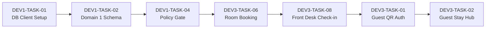
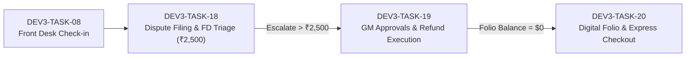

# Master Backend Architecture & 3-Developer Work Division Specification (Revision 2 — Final Audit)

```text
========================================================================================
STATUS: DRAFT — PENDING TEAM REVIEW AND ARCHITECTURAL APPROVAL
DOCUMENT VERSION: 2.2.0 (Audited & Dependency Graph Baseline)
SUPERSEDES: Revision 1.0 (Retained for historical audit)
ASSIGNMENTS:
  • DEVELOPER 1: Platform Foundation, Database Infrastructure, Identity & RBAC, Shared Outbox & Executive Analytics
  • DEVELOPER 2: Core Operational Workflow Engine, Canonical Task State Machine, Dispatcher, SLAs & Security Vault
  • DEVELOPER 3 (User): Guest Portal, Front Desk, Fulfiller-Facing API Integration, Folio & Financial Disputes
========================================================================================
```

---

## Executive Summary & Core Architectural Directives

Following comprehensive technical audit and reconciliation against all physical repository assets, this document establishes the finalized **Revision 2** specification. It resolves all feature traceability mismatches, specifies type-safe cross-developer service contracts, eliminates authentication ambiguities, clarifies database entity ownership, provides an actionable 20-task implementation roadmap for **Developer 3 (User)**, and details the master three-developer task dependency graph.

### Key Architectural Directives in this Final Audit:
1. **Developer 3 Scope & Strict Canonical Engine Boundary:** Developer 3 owns the **Guest Portal**, **Front Desk**, **Fulfiller-Facing API Layer**, and **Financial Disputes**. Developer 2 retains 100% exclusive ownership of the **canonical task engine, task state machine, task assignment logic, and shared task database persistence**. Developer 3 never duplicates task tables or state machines; all fulfiller transitions and guest requests delegate directly to Developer 2's canonical domain services.
2. **Defensible Workload Rebalancing (160 Story Points Total):** Workload is balanced using realistic story-point complexity: Developer 1 holds 52 SP (32.5%), Developer 2 holds 55 SP (34.4%), and Developer 3 holds 53 SP (33.1%)—achieving a variance within 1.9%. Developer 1 absorbs Executive Analytics (`F39`), while Developer 2 absorbs F&B Dining Menu catalog (`F28`), Kitchen tracking (`F29`), and Maintenance asset registry (`F25`).
3. **Repository Location (Option A+ Colocated Monorepo):** In accordance with `DEPLOYMENT.md` (where Vercel's root directory is set to `public-preview`), all backend HTTP Route Handlers reside inside `public-preview/src/app/api/v1/`. Because Vercel functions are serverless and cannot host persistent timers, background workers reside in `public-preview/src/server/workers/` to be executed via a dedicated container runtime.
4. **Deterministic Migration Governance:** Numerical migration prefixes do not prevent journal divergence across branches. A formal **Migration Integrator protocol** is established: feature PRs submit only TypeScript schema definitions (`*.ts`), while migration SQL files are generated and applied centrally on `main` by Developer 1.
5. **Separation of Approval and Execution Authorities:** Financial policy enforces that Approvers (Front Desk, Duty Manager, GM) cannot execute payouts, and Executors (Financial Operators) cannot approve exceptions. Production threshold amounts are verified as **Pending Management Decision `P-06`** in `DECISIONS.md`, and are managed dynamically via the `financial_limit` table rather than hardcoded constants.

---

# PART 1 — COMPREHENSIVE SOURCE DOCUMENT & FEATURE TRACEABILITY AUDIT

## 1.1 Complete Reconciliation of Feature IDs Against Original Documentation

Every feature ID from `Tech_Team_Sprint_Backlog_and_Architecture.xlsx` (Sheet 1 `Core_Feature_Spec`, Sheet 2 `New_Features_How_To_Build`, Sheet 3 `State_Machines_and_RBAC`), `Tech_Team_Project_Guide_and_Feature_Spec.pdf`, and `PRD.md` is strictly reconciled below:

### A. Original Workbook Features (Sheet 1: `Core_Feature_Spec`)
| Original Feature ID | Exact Original Feature Name | Target Module | Owner | Core DB Tables Owned | Original Document Reference |
|---|---|---|:---:|---|---|
| **F01** | Secure Stay-Linked QR Access | Guest Portal | **DEV 3** | `stay_context`, `room_assignment`, `guest_session`, `qr_mapping` | XLSX Sheet 1 (Row A5), Spec PDF p. 3 |
| **F02** | Unified Stay Dashboard | Guest Portal | **DEV 3** | Reads `stay_context`, calls D2 `TaskQueryService` | XLSX Sheet 1 (Row A6), Spec PDF p. 3 |
| **F04** | Digital DND & Make-Up-Room Sync | Housekeeping | **DEV 3** (Route/DND) / **DEV 2** (Task) | `room_assignment.dnd_active` | XLSX Sheet 1 (Row A17), Spec PDF p. 3 |
| **F05** | Multilingual & Accessible UI | Guest Portal | **DEV 3** | i18n JSON translation assets | XLSX Sheet 1 (Row A7), Spec PDF p. 3 |
| **F08** | Pre-Arrival Registration | Booking & Arrival | **DEV 3** | `stay_context`, `attachment` | XLSX Sheet 1 (Row A8), Spec PDF p. 3 |
| **F09** | Early Check-In / Late Checkout | Booking & Arrival | **DEV 3** | `stay_context`, `folio_adjustment` | XLSX Sheet 1 (Row A9), Spec PDF p. 3 |
| **F12** | Room Discovery & Booking Engine | Public Website | **DEV 3** | `stay_context`, `room_assignment` | `FRONTEND_FEATURE_MAP.md`, Diagram 3 |
| **F14** | Booking-Payment Reconciliation | Booking & Arrival | **DEV 3** | `connector_outbox`, `stay_context` | XLSX Sheet 1 (Row A10), Spec PDF p. 2 |
| **F15** | Smart Task Auto-Assignment | Operations | **DEV 2** | `department_task`, `task_event` | XLSX Sheet 1 (Row A11), Spec PDF p. 3 |
| **F16** | Separate Response & Resolution SLAs | Operations | **DEV 2** | `sla_policy`, `department_task` | XLSX Sheet 1 (Row A12), Spec PDF p. 3 |
| **F17** | Complete Ticket State Machine | Operations | **DEV 2** | `department_task`, `task_event` | XLSX Sheet 1 (Row A13), Spec PDF p. 4 |
| **F19** | Shift Handover Dashboard | Operations | **DEV 2** | `handover` | XLSX Sheet 1 (Row A14), Spec PDF p. 3 |
| **F21** | Room Readiness Board | Housekeeping | **DEV 3** (FD Board) / **DEV 2** (Inspection) | `room_assignment` | XLSX Sheet 1 (Row A15), Spec PDF p. 2 |
| **F22** | Digital Cleaning Checklists | Housekeeping | **DEV 2** | `task_checklist_item`, `task_event` | XLSX Sheet 1 (Row A16), Spec PDF p. 3 |
| **F25** | Asset Registry & Preventive Tasks | Maintenance | **DEV 2** | `maintenance_asset`, `department_task` | XLSX Sheet 1 (Row A18), Spec PDF p. 3 |
| **F27** | Out-of-Service Room Block Approval | Maintenance | **DEV 2** (Block req) / **DEV 3** (Inventory) | `room_assignment`, `guest_case` | XLSX Sheet 1 (Row A19), Spec PDF p. 3 |
| **F28** | Live Menu, 86'd Items & Allergens | F&B Ordering | **DEV 2** | `dining_menu_item`, `outlet` | XLSX Sheet 1 (Row A20), Spec PDF p. 3 |
| **F29** | Kitchen Capacity & Delivery Tracking | F&B Ordering | **DEV 2** | `dining_order`, `department_task` | XLSX Sheet 1 (Row A21), Spec PDF p. 3 |
| **F32** | Complaint & Recovery Case Mgmt | Service Recovery | **DEV 2** (Escalation) / **DEV 3** (Dispute) | `guest_case`, `financial_exception` | XLSX Sheet 1 (Row A22), Spec PDF p. 3 |
| **F34** | Digital Checkout & Exception Check | Billing & Checkout | **DEV 3** | `stay_context`, `guest_session`, `folio_adjustment` | XLSX Sheet 1 (Row A23), Spec PDF p. 2 |
| **F38** | Scoped RBAC & Property Isolation | Platform & Security | **DEV 1** | `staff_membership`, `profile_grant`, `grant_scope` | XLSX Sheet 1 (Row A24), Spec PDF p. 5 |

### B. Original Operational Requirements (from PRD & 13 Workflow Diagrams)
| Requirement ID | Operational Capability | Primary Owner | Entities Owned | Source Reference |
|---|---|:---:|---|---|
| **REQ-01 / F41** | Staff Account Provisioning & Role Grants | **DEV 1** | `staff_account`, `profile`, `permission`, `profile_grant` | PRD REQ-01, Diagram 1 |
| **REQ-02 / F03** | In-Room Guest Service Request Intake | **DEV 3** (Route) / **DEV 2** (Engine) | `guest_case`, `department_task` | PRD REQ-02, Diagram 9 |
| **REQ-03 / F23** | Automated SLA Breach Escalation Engine | **DEV 2** | `escalation`, `coverage_contact` | PRD REQ-03, Diagram 4 |
| **REQ-04 / F39** | Executive BI & Department Performance KPIs | **DEV 1** | Analytical read-only aggregation engine | PRD REQ-04, Diagram 7 |
| **REQ-05 / F20** | Shift Handover Logging & Continuity | **DEV 2** | `handover` | PRD REQ-05, Diagram 13 |
| **REQ-06 / F06** | SOS / Panic Alarm Dispatch (Protocol E-1) | **DEV 2** | `incident`, `incident_action` | Spec PDF Feature #6, Diagram 11 |
| **REQ-07 / F11** | Room Move Engine with Immediate Revocation | **DEV 3** | `stay_context`, `room_assignment`, `guest_session` | PRD REQ-07, Diagram 6 |
| **REQ-08 / F31** | Financial Dispute Triage & Payout Execution | **DEV 3** | `financial_exception`, `approval`, `execution` | PRD REQ-08, Diagram 2 |
| **REQ-09 / F37** | Restricted Incident Evidence Vault | **DEV 2** | `incident_access`, `incident_evidence` | PRD REQ-09, SEC Doc |
| **REQ-10 / F40** | Physical Property, Floor & Room Inventory | **DEV 1** | `property`, `floor`, `room`, `outlet`, `shift` | PRD REQ-10, Diagram 1 |
| **REQ-11 / F42** | Central Immutable Audit Trail Logging | **DEV 1** | `audit_event` | PRD REQ-11, Diagram 1 |
| **FD-01 / F10** | Front Desk Walk-In / Phone Case Intake | **DEV 3** (Route) / **DEV 2** (Engine) | `guest_case`, `department_task` | Diagram 6 (Front Desk) |
| **FD-02 / F30** | Front Desk Guest Reminders & Wake-Up Alarms | **DEV 3** | `guest_reminder` | Diagram 6 (Front Desk) |
| **FD-03 / F29-LF**| Lost & Found Item Registry & Matching | **DEV 3** | `lost_found_item` | Diagram 6 (Front Desk) |
| **FD-04 / F38-BC**| Emergency Alert Broadcast System | **DEV 3** | `emergency_broadcast` | Diagram 6 (Front Desk) |

### C. Additional Features from Sheet 2 (`New_Features_How_To_Build`)
| New Feature ID | Feature Name | Planned Scope & Allocation | Implementation Status |
|---|---|:---:|---|
| **NEW-01** | WhatsApp Two-Way Guest Bridge | **Deferred / Out of Scope for MVP** | Requires external Meta Cloud / Twilio API contract. Deferred to Post-MVP. |
| **NEW-02** | 1-Tap Instant Payment Links (UPI / Apple Pay) | **DEV 3** (Sprint 2) | Supported in Express Checkout (`POST /api/v1/guest/checkout/pay-link`). |
| **NEW-03** | Guest Instant Compensation Voucher | **DEV 3** (Sprint 2) | Supported in Dispute Triage (`POST /api/v1/disputes/:id/issue-voucher`). |
| **NEW-04** | Express Camera ID Scan & OCR Pre-Check-In | **DEV 3** (Sprint 2) | S3 presigned upload via Dev 1; OCR parsing in Pre-Arrival (`F08`). |
| **NEW-05** | QR Self-Declaration Minibar & Laundry Cart | **DEV 3** (Sprint 2) | Idempotent room charge posting into `folio_adjustment`. |
| **NEW-06** | 1-Tap Staff SOS / Panic Alert Button | **DEV 2** (Sprint 1) | High-priority trigger in Staff App calling Dev 2 Security Incident engine. |
| **NEW-07** | Automated Flight / Train Delay Pickup Sync | **Deferred / Out of Scope for MVP** | External FlightAware / Aviationstack connector pending IT procurement. |
| **NEW-08** | Zero-Install PWA Push & Sound Alerts | **DEV 1** (VAPID key infra) / **DEV 2** (Alerts) | Web Push service worker alert dispatch on task assignment and alarms. |

---

# PART 2 — REPOSITORY ARCHITECTURE DECISION: OPTION A vs OPTION B

The physical repository at `d:\Code\ADP\hotel-app-main` contains the deployed Next.js 15 application inside `public-preview/`. The root directory contains a delegated configuration.

```text
d:\Code\ADP\hotel-app-main\
├── package.json               <-- Delegated workspace root ("hotel-app-root")
├── public-preview/            <-- ACTIVE Next.js 15 application (configured in Vercel)
│   ├── package.json           <-- Dependencies, scripts, build config ("hotel-app-main")
│   ├── src/
│   │   ├── app/               <-- Next.js App Router pages and layouts
│   │   ├── components/        <-- UI components for all 9 roles + Guest Portal
│   │   ├── lib/               <-- Frontend store, mockData, utilities
│   │   └── types/             <-- TypeScript interfaces
│   └── tests/                 <-- Domain test suites
```

## 2.1 Architectural Evaluation

```text
┌────────────────────────────────────────────────────────────────────────────────────────┐
│ OPTION A: Colocated Inside `public-preview/` (Next.js App Router API Handlers)        │
│                                                                                        │
│ Pros:                                                                                  │
│ • Zero CORS configuration: Same origin (/api/v1/...) for UI and API.                   │
│ • Matches existing Vercel deployment root (configured in DEPLOYMENT.md).              │
│ • Direct import of shared TypeScript types between frontend and backend.              │
│                                                                                        │
│ Cons & Architectural Bottlenecks:                                                      │
│ • Vercel Route Handlers are SERVERLESS (ephemeral Lambdas).                           │
│ • CANNOT run persistent BullMQ workers, WebSocket servers, or in-memory cron timers.  │
│                                                                                        │
│ Solution: Colocate HTTP API in `public-preview/src/app/api/v1/`, but isolate           │
│ background workers into `public-preview/src/server/workers/` executed via a dedicated │
│ long-running container process (e.g. Docker / Railway / Render).                      │
└────────────────────────────────────────────────────────────────────────────────────────┘
                                            VS
┌────────────────────────────────────────────────────────────────────────────────────────┐
│ OPTION B: Separate Backend Application at Root (`server/` or `backend/`)              │
│                                                                                        │
│ Pros:                                                                                  │
│ • Pure long-running Node.js process (Fastify / Express) with native BullMQ workers.   │
│ • Completely independent deployment and scaling lifecycle.                            │
│                                                                                        │
│ Cons & Friction:                                                                       │
│ • Requires re-configuring Vercel project roots or managing multi-service hosting.      │
│ • Requires cross-origin CORS handling, cookie domain configuration, and duplicated     │
│   type definitions or monorepo workspace tooling.                                      │
└────────────────────────────────────────────────────────────────────────────────────────┘
```

## 2.2 Definitive Architectural Decision: OPTION A+ (Colocated Monorepo Architecture)

**The backend will reside inside `public-preview/`**, leveraging Next.js 15 Route Handlers for the HTTP API layer while creating a dedicated server runtime directory for background workers.

### Directory Structure & Exact Paths
```text
public-preview/
├── package.json                       [Managed by DEV 1]
├── drizzle.config.ts                  [Managed by DEV 1]
├── .env.example                       [Managed by DEV 1]
├── src/
│   ├── app/
│   │   └── api/
│   │       └── v1/                    <-- HTTP ROUTE HANDLERS
│   │           ├── auth/              [DEV 1] Login, refresh, session callback
│   │           ├── admin/             [DEV 1] Staff provisioning, grants, org, audit
│   │           ├── infra/             [DEV 1] S3 presigned URLs, health check
│   │           ├── analytics/         [DEV 1] Executive KPIs, department metrics
│   │           ├── dispatch/          [DEV 2] Queue management, staff task assignment
│   │           ├── supervisor/        [DEV 2] QA task inspection, reopen, handovers
│   │           ├── escalations/       [DEV 2] SLA breach monitor, active alerts
│   │           ├── security/          [DEV 2] SOS panic alarm, incident reports, evidence
│   │           ├── guest/             [DEV 3] QR auth, stay summary, requests, checkout
│   │           ├── frontdesk/         [DEV 3] Stays, check-in, room moves, readiness
│   │           ├── fulfiller/         [DEV 3] My Tasks, atomic transitions, blockers
│   │           └── finance/           [DEV 3] Claims triage, GM approvals, refunds
│   ├── server/                        <-- DOMAIN BUSINESS LOGIC ENGINES
│   │   ├── db/
│   │   │   ├── index.ts               [DEV 1] Database client connection pool
│   │   │   └── schema/
│   │   │       ├── 01_identity.ts     [DEV 1] Staff, profiles, grants, org, audit
│   │   │       ├── 02_operations.ts   [DEV 2] Cases, tasks, SLAs, security incidents
│   │   │       └── 03_finance.ts      [DEV 3] Stays, QR, disputes, refunds, folios
│   │   ├── modules/
│   │   │   ├── identity/              [DEV 1] PolicyEngineService, TokenService
│   │   │   ├── operations/            [DEV 2] TaskEngineService, TaskLifecycleService, TaskQueryService
│   │   │   ├── sla/                   [DEV 2] SlaEngineService, EscalationService
│   │   │   ├── security/              [DEV 2] SecurityIncidentService
│   │   │   ├── guest/                 [DEV 3] GuestSessionService, QrAuthService
│   │   │   ├── frontdesk/             [DEV 3] FrontDeskStayService, RoomMoveService
│   │   │   ├── fulfiller/             [DEV 3] FulfillerAdapterService
│   │   │   └── finance/               [DEV 3] DisputeTriageService, RefundExecutionService
│   │   └── workers/                   <-- PERSISTENT BACKGROUND WORKERS (BullMQ)
│   │       ├── index.ts               [DEV 1] Worker bootstrap process
│   │       ├── slaWorker.ts           [DEV 2] Delayed SLA breach checker
│   │       └── outboxWorker.ts        [DEV 1] Transactional outbox event pump
│   └── lib/
│       └── contracts/                 [DEV 1] Shared enums, interfaces, error types
```

---

# PART 3 — MASTER BACKEND FEATURE INVENTORY (F01–F42)

The feature inventory covers all 42 backend capabilities, identifying their single implementation owner, dependencies, and official source:

| Feat ID | Feature Name | Single Impl Owner | Consuming Roles | Required Backend Functionality | Entities Owned | Source Document |
|---|---|:---:|---|---|---|---|
| **F01** | Stay-Linked QR Auth | **DEV 3** | Guest, Front Desk | Validates room QR secret, checks stay dates, issues guest JWT | `GUEST_SESSION`, `QR_MAPPING` | Spec #1, PRD REQ-07 |
| **F02** | Unified Stay Dashboard | **DEV 3** | Guest | Returns stay details, room attributes, active ticket projections | Reads `STAY_CONTEXT`, calls D2 | Spec #2, Diagram 3 |
| **F03** | Guest Request Intake | **DEV 3** (Route) / **DEV 2** (Logic) | Guest, Ops | D3 validates session, calls D2 `TaskEngineService.createCaseAndTask` | `GUEST_CASE`, `DEPARTMENT_TASK` | Spec #3, Diagram 9 |
| **F04** | Digital DND Sync | **DEV 3** | Guest, Housekeeping | Updates `room_assignment.dnd_active`; suppresses cleaning tasks | `ROOM_ASSIGNMENT` | Spec #4, Diagram 8 |
| **F05** | Guest Feedback & Ratings | **DEV 3** | Guest, Executive | Appends post-fulfillment star rating and review note to case | `GUEST_CASE` | Spec #5 |
| **F06** | SOS Panic Alarm Dispatch | **DEV 2** | Guest, Security | High-priority WebSocket alarm broadcast; creates security incident | `INCIDENT`, `INCIDENT_ACTION` | Spec #6, Diagram 11 |
| **F07** | Staff OIDC Auth & MFA | **DEV 1** | All Staff, IT | Validates OIDC login, verifies MFA, issues scoped session cookie | `STAFF_ACCOUNT`, `STAFF_MEMBERSHIP` | PRD REQ-01, SEC Doc |
| **F08** | Pre-Arrival Registration | **DEV 3** | Guest, Front Desk | Captures arrival ETA, photo ID, advances stay to `pending_verify` | `STAY_CONTEXT`, `ATTACHMENT` | Spec #8, Diagram 6 |
| **F09** | Early Check-In / Late Out | **DEV 3** | Guest, Front Desk | Checks room readiness, calculates dynamic fee, updates departure | `STAY_CONTEXT`, `FOLIO_ADJUSTMENT` | Spec #9, Diagram 6 |
| **F10** | Front Desk Case Intake | **DEV 3** (Route) / **DEV 2** (Logic) | Front Desk, Ops | Front Desk logs in-person request; calls D2 canonical task engine | `GUEST_CASE`, `DEPARTMENT_TASK` | Spec #10, Diagram 6 |
| **F11** | Room Move Engine | **DEV 3** | Front Desk | Transfers stay to new room, immediately revokes old QR sessions | `ROOM_ASSIGNMENT`, `GUEST_SESSION` | PRD REQ-07, Diagram 6 |
| **F12** | Room Discovery & Booking | **DEV 3** | Public Guest | Queries room inventory, generates reservation, creates stay context | `STAY_CONTEXT` | Spec #12, Diagram 3 |
| **F13** | Digital Folio Calculation | **DEV 3** | Guest, Finance | Aggregates room rate, F&B, spa charges, vouchers, and disputes | `FOLIO_ADJUSTMENT` | Spec #13, Diagram 2 |
| **F14** | PMS-Payment Sync Fallback | **DEV 3** | Front Desk, Finance | Queues unconfirmed bookings, triggers webhook retry or refund | `CONNECTOR_OUTBOX`, `STAY_CONTEXT` | Spec #14, Diagram 2 |
| **F15** | Smart Task Auto-Assignment | **DEV 2** | Dispatcher | Assigns staff member; validates on-duty shift and active workload | `DEPARTMENT_TASK`, `TASK_EVENT` | Spec #15, Diagram 9 |
| **F16** | Response & Resolution SLAs | **DEV 2** | System, All | Computes ack_due_at and completion_due_at per category/priority | `SLA_POLICY` | Spec #16, Diagram 9 |
| **F17** | Complete Ticket State Machine | **DEV 2** | All Ops Staff | State machine: `assigned` $\rightarrow$ `in_progress` $\rightarrow$ `on_the_way` $\rightarrow$ `completed` | `DEPARTMENT_TASK`, `TASK_EVENT` | PRD REQ-02, Diagram 9 |
| **F18** | Blocker Reporting Logic | **DEV 2** | Fulfiller, Dispatcher | Transitions task to `blocked`; records mandatory reason and photo | `DEPARTMENT_TASK`, `TASK_EVENT` | Spec #18, Diagram 9 |
| **F19** | Shift Handover Dashboard | **DEV 2** | Supervisor | Submits unresolved obligations; pins to incoming supervisor queue | `HANDOVER` | Spec #19, Diagram 13 |
| **F20** | Shift Continuity Management | **DEV 2** | Supervisor | Carryover tracking for open tasks across morning/evening/night | `HANDOVER` | Spec #20, Diagram 13 |
| **F21** | Room Readiness Board | **DEV 3** (FD Board) / **DEV 2** (Insp) | Housekeeping, FD | Manages `dirty` $\rightarrow$ `cleaning` $\rightarrow$ `inspected` $\rightarrow$ `ready` transitions | `ROOM_ASSIGNMENT` | Spec #21, Diagram 8 |
| **F22** | Cleaning Checklists | **DEV 2** | Housekeeping | Validates required checklist items before cleaner submits inspection | `TASK_EVENT` | Spec #22, Diagram 8 |
| **F23** | Automated SLA Escalation | **DEV 2** | System, Duty Mgr | BullMQ timer fires on overdue; escalates Supervisor $\rightarrow$ DM $\rightarrow$ GM | `ESCALATION` | PRD REQ-03, Diagram 4 |
| **F24** | Duty Manager Recovery Case | **DEV 2** | Duty Manager | Cross-department incident coordination and emergency tasks | `GUEST_CASE`, `DEPARTMENT_TASK` | Spec #24, Diagram 4 |
| **F25** | Asset Registry & Preventive | **DEV 2** | Maintenance, DM | Recurring maintenance schedules; engineer requests room block | `GUEST_CASE`, `ROOM` | Spec #25, Diagram 10 |
| **F26** | Dining Menu Customization | **DEV 2** | F&B, Guest | Dietary preferences, modifiers, special cooking instructions | `TASK_CATEGORY`, `OUTLET` | Spec #26, Diagram 5 |
| **F27** | Out-of-Service Room Block | **DEV 2** (Block req) / **DEV 3** (Inv) | Maintenance, DM | Engineer flags room block; Duty Manager approves; syncs to PMS | `ROOM_ASSIGNMENT`, `GUEST_CASE` | Spec #27, Diagram 10 |
| **F28** | Live Menu, 86'd Items | **DEV 2** | F&B, Guest | Categorized dining menu catalog, dietary tags, stock toggle | `TASK_CATEGORY`, `OUTLET` | Spec #28, Diagram 5 |
| **F29** | Kitchen Capacity & Orders | **DEV 2** | F&B, Runner, Guest | Kitchen prep tracking $\rightarrow$ runner en route $\rightarrow$ delivered | `DEPARTMENT_TASK` | Spec #29, Diagram 5 |
| **F30** | Guest Reminder Alarms | **DEV 3** | Front Desk | Configures scheduled wake-up or service alarms with timer dispatch | `GUEST_REMINDER` | Spec #30, Diagram 6 |
| **F31** | Dispute Intake & FD Triage | **DEV 3** | Front Desk, Guest | Triage claim: approves credit if $\le$ ₹2,500; escalates if > ₹2,500 | `FINANCIAL_EXCEPTION`, `APPROVAL` | Spec #31, Diagram 2 |
| **F32** | Complaint & Recovery Mgmt | **DEV 2** (Escalation) / **DEV 3** (Disp)| Duty Mgr, GM | Multi-tier service recovery compensation approval workflow | `GUEST_CASE`, `FINANCIAL_APPROVAL`| Spec #32, Diagram 4 |
| **F33** | Refund Execution Engine | **DEV 3** | Financial Operator | Executes approved card refund or bank credit; records provider ref | `FINANCIAL_EXECUTION` | PRD REQ-08, Diagram 2 |
| **F34** | Digital Checkout & Folio | **DEV 3** | Guest, Front Desk | Validates balance == 0, signs folio, checks out, revokes QR token | `STAY_CONTEXT`, `GUEST_SESSION` | Spec #34, Diagram 2 |
| **F35** | Express Checkout Settlement | **DEV 3** | Guest, Front Desk | Digital signature, payment settlement, and automated departure | `STAY_CONTEXT`, `GUEST_SESSION` | Spec #35, Diagram 2 |
| **F36** | Security Incident Report | **DEV 2** | Security | Logs incident, records timeline, files formal report with evidence | `INCIDENT`, `INCIDENT_ACTION` | Spec #36, Diagram 11 |
| **F37** | Restricted Incident Vault | **DEV 2** | Security, DM | Enforces strict isolation boundary; non-security cannot read | `INCIDENT_ACCESS`, `EVIDENCE` | PRD REQ-09, SEC Doc |
| **F38** | Scoped Property Isolation | **DEV 1** | Platform Admin | Middleware validates `User.role` + `Property_ID` + `Dept_ID` | `STAFF_MEMBERSHIP`, `GRANT_SCOPE` | Spec #38, Diagram 1 |
| **F39** | Executive BI & KPIs | **DEV 1** | Executive, GM | Computes SLA compliance %, turnaround time, satisfaction metrics | Read-only aggregation engine | Spec #39, Diagram 7 |
| **F40** | Physical Property Org | **DEV 1** | Platform Admin | CRUD for Properties, Floors, Rooms, Outlets, and Shift rosters | `PROPERTY`, `FLOOR`, `ROOM` | PRD REQ-10, Diagram 1 |
| **F41** | Staff Account & RBAC | **DEV 1** | Platform Admin | Manages staff accounts, assigns profile grants and department scopes | `STAFF_ACCOUNT`, `PROFILE_GRANT`| PRD REQ-01, Diagram 1 |
| **F42** | Immutable Audit Trail | **DEV 1** | Platform Admin, All | Records every security, financial, and operational action immutably | `AUDIT_EVENT` | PRD REQ-11, Diagram 1 |

---

# PART 4 — THREE-PERSON WORKSTREAM REALLOCATION & EFFORT ANALYSIS (160 SP)

## 4.1 Rebalanced Allocations

To incorporate Developer 3's preferred expansion (Fulfiller-Facing API layer) without creating an overloaded workstream, non-core capabilities were strategically redistributed:
- **Developer 1 (Platform, Security & Infrastructure Lead):** Owns Core DB engine, OIDC Auth, Central Policy Engine, Physical Org Hierarchy, Transactional Outbox, S3 Storage Vault, and **Executive Analytics & Reporting Engine** (`F39`).
- **Developer 2 (Operations, Workflows & Task Engine Lead):** Owns Canonical Case & Task Engine, Dispatcher console, Task State Machine, SLA Timers & Escalations, Shift Handovers, Security Incident Vault, and **Dining/Spa Catalogues & Orders** (`F28`, `F29`, `F25`).
- **Developer 3 (User — Guest, Front Desk, Fulfiller & Finance Lead):** Owns Guest QR Session & Portal, Front Desk Console, Stays & Room Moves, **Fulfiller-Facing Authenticated API Layer**, and Financial Disputes, Approvals & Refund Execution.

## 4.2 Defensible Workload Estimation (Story Points)

```text
┌───────────────────────────────────────────────┬───────────────────────────────────────────────┬───────────────────────────────────────────────┐
│         DEVELOPER 1: 52 STORY POINTS          │         DEVELOPER 2: 55 STORY POINTS          │     DEVELOPER 3 (USER): 53 STORY POINTS       │
├───────────────────────────────────────────────┼───────────────────────────────────────────────┼───────────────────────────────────────────────┤
│ • Core DB Client & Drizzle Setup:        5 SP │ • Canonical Case & Task Entity Engine:   8 SP │ • Guest QR Auth & Session Lifecycle:     5 SP │
│ • OIDC JWT Auth & Refresh Service:       8 SP │ • Task State Machine & Concurrency:      8 SP │ • Guest Portal Hub & Request Intake:     5 SP │
│ • Scoped Policy Gate (RBAC / Scopes):    8 SP │ • Dispatcher Queue & Auto-Assignment:    5 SP │ • Front Desk Stays & Arrival Check-in:   5 SP │
│ • Org Hierarchy CRUD (Property, Rooms):  5 SP │ • SLA Target Calculator & BullMQ Timers: 8 SP │ • Room Move Engine & Session Revocation: 5 SP │
│ • Transactional Outbox Worker:           5 SP │ • Multi-Tier Escalations (DM / GM):      5 SP │ • Room Readiness Board:                  3 SP │
│ • S3 Presigned URL & Quarantine Vault:   5 SP │ • Supervisor Inspection & Handovers:     5 SP │ • Fulfiller API Layer (My Tasks, Proj):  5 SP │
│ • Immutable Audit Logging Engine:        5 SP │ • Security Incidents & Panic SOS:        5 SP │ • Fulfiller Transitions & Blockers:      5 SP │
│ • Executive Analytics & KPI Aggregates:  8 SP │ • Restricted Incident Evidence Vault:    5 SP │ • Dispute Triage (₹2,500 Limit):         5 SP │
│ • Admin IT Console Backend:              3 SP │ • Dining Orders (KDS) & Spa Catalog:     6 SP │ • GM Approvals & Refund Execution:       5 SP │
│                                               │                                               │ • Express Checkout & Folio Settlement:   5 SP │
└───────────────────────────────────────────────┴───────────────────────────────────────────────┴───────────────────────────────────────────────┘
```
**Total Project Effort:** 160 Story Points | **Dev 1:** 52 SP (32.5%) | **Dev 2:** 55 SP (34.4%) | **Dev 3:** 53 SP (33.1%)

---

# PART 5 — FULFILLER INTEGRATION BOUNDARY & SHARED SERVICE CONTRACTS

## 5.1 Type-Safe Service Contracts (Zero `any` Types)

Developer 2 exports the following TypeScript contracts from `src/server/modules/operations/contracts.ts`:

```typescript
// src/server/modules/operations/contracts.ts

export type TaskPriority = 'low' | 'normal' | 'urgent' | 'safety_critical';
export type TaskStatus = 'submitted' | 'assigned' | 'in_progress' | 'on_the_way' | 'completed' | 'blocked' | 'cancelled' | 'reopened';

export interface CreateCaseAndTaskInput {
  propertyId: string;
  stayId?: string;
  roomId?: string;
  department: string;
  category: string;
  priority: TaskPriority;
  source: 'guest_portal' | 'front_desk' | 'system';
  instructions: string;
  createdByStaffId?: string;
  attachments?: Array<{ name: string; url: string; size: number; mimeType: string }>;
}

export interface CanonicalTaskResult {
  caseId: string;
  caseRef: string;
  taskId: string;
  department: string;
  status: TaskStatus;
  ackDueAt: Date;
  completionDueAt: Date;
}

export interface TaskTransitionInput {
  taskId: string;
  staffId: string;
  action: 'accept' | 'start' | 'on_the_way' | 'complete';
  targetStatus: TaskStatus;
  note?: string;
  checklistResponses?: Record<string, boolean>;
  attachments?: string[];
}

export interface TaskBlockInput {
  taskId: string;
  staffId: string;
  reason: string;
  evidencePhotoUrl?: string;
}

export interface GuestTaskProjection {
  taskId: string;
  category: string;
  department: string;
  status: 'received' | 'in_progress' | 'on_the_way' | 'completed' | 'blocked';
  statusLabel: string;
  createdAt: string;
  estimatedCompletionAt?: string;
  completedAt?: string;
}

export interface FulfillerTaskProjection {
  taskId: string;
  caseRef: string;
  roomNumber: string;
  floor: number;
  category: string;
  department: string;
  priority: TaskPriority;
  status: TaskStatus;
  instructions: string;
  guestDndActive: boolean;
  assignedAt: string;
  ackDueAt: string;
  completionDueAt: string;
  checklistItems: Array<{ id: string; label: string; required: boolean }>;
}

export interface ITaskEngineService {
  createCaseAndTask(input: CreateCaseAndTaskInput): Promise<CanonicalTaskResult>;
}

export interface ITaskLifecycleService {
  transitionTask(input: TaskTransitionInput): Promise<{ taskId: string; status: TaskStatus; updatedAt: Date }>;
  blockTask(input: TaskBlockInput): Promise<{ taskId: string; status: 'blocked'; blockedAt: Date; reason: string }>;
}

export interface ITaskQueryService {
  getTasksForStaff(staffId: string): Promise<FulfillerTaskProjection[]>;
  getTasksForStay(stayId: string): Promise<GuestTaskProjection[]>;
  getTaskById(taskId: string): Promise<FulfillerTaskProjection | null>;
}
```

---

# PART 6 — DATABASE ARCHITECTURE, ENTITY OWNERSHIP (44 ENTITIES) & SAFE MIGRATIONS

## 6.1 Reconciled Entity Ownership Matrix

Every database table is assigned to exactly ONE developer, with explicit PostgreSQL foreign keys:

```text
┌───────────────────────────────────────────────┬───────────────────────────────────────────────┬───────────────────────────────────────────────┐
│           DEVELOPER 1 (15 ENTITIES)           │           DEVELOPER 2 (15 ENTITIES)           │           DEVELOPER 3 (14 ENTITIES)           │
├───────────────────────────────────────────────┼───────────────────────────────────────────────┼───────────────────────────────────────────────┤
│ 1.  property                                  │ 1.  guest_case                                │ 1.  stay_context                              │
│ 2.  department                                │ 2.  case_message                              │ 2.  room_assignment                           │
│ 3.  outlet                                    │ 3.  case_link                                 │ 3.  qr_mapping                                │
│ 4.  floor                                     │ 4.  department_task                           │ 4.  guest_session                             │
│ 5.  room                                      │ 5.  task_category                             │ 5.  attachment (general & pre-arrival ID)     │
│ 6.  shift                                     │ 6.  task_event                                │ 6.  folio_adjustment                          │
│ 7.  staff_account                             │ 7.  task_checklist_item                       │ 7.  financial_exception                       │
│ 8.  staff_membership                          │ 8.  sla_policy                                │ 8.  financial_approval                        │
│ 9.  profile                                   │ 9.  coverage_contact                          │ 9.  financial_execution                       │
│ 10. permission                                │ 10. escalation                                │ 10. reconciliation                            │
│ 11. profile_grant                             │ 11. handover                                  │ 11. financial_evidence                        │
│ 12. grant_scope                               │ 12. incident                                  │ 12. lost_found_item                           │
│ 13. financial_limit (RBAC limit caps)         │ 13. incident_access                           │ 13. guest_reminder                            │
│ 14. audit_event                               │ 14. incident_action                           │ 14. emergency_broadcast                       │
│ 15. connector_outbox                          │ 15. incident_evidence (quarantined)           │                                               │
│                                               │ 16. maintenance_asset (AC/equipment - F25)    │                                               │
│                                               │ 17. dining_menu_item (catalog/allergens - F28)│                                               │
│                                               │ 18. dining_order (kitchen orders/KDS - F29)   │                                               │
└───────────────────────────────────────────────┴───────────────────────────────────────────────┴───────────────────────────────────────────────┘
```

## 6.2 Safe Migration & Schema Integration Strategy
- **Schema Files:** Authoring occurs only in `01_identity.ts` (Dev 1), `02_operations.ts` (Dev 2), and `03_finance.ts` (Dev 3).
- **Zero Migrations on Feature Branches:** Developers use `npm run db:push` in local Docker environments. Migration SQL files are generated only on `main` by Developer 1 (Migration Integrator) during sprint integration gates, ensuring a single linear `_journal.json` history.

---

# PART 7 — FINANCIAL DECISIONS, ROLES & APPROVAL TIERS

## 7.1 Status of Decision `P-06`
In accordance with `DECISIONS.md`, **Decision `P-06` remains Pending Management Approval**. Specific production currency caps will be confirmed prior to release. The prototype implements dynamic, configurable limits via the `financial_limit` table:

```text
┌─────────────────────────┬───────────────────────┬────────────────────────────────────────────────────────┐
│ Role                    │ Max Approval Limit    │ Permitted Actions & Invariants                         │
├─────────────────────────┼───────────────────────┼────────────────────────────────────────────────────────┤
│ Front Desk Coordinator  │ ₹2,500                │ Triage & instant voucher/credit. Above ₹2,500          │
│ (Sunita Patel)          │ (Per stay dispute)    │ automatically routes to General Manager queue.         │
├─────────────────────────┼───────────────────────┼────────────────────────────────────────────────────────┤
│ Duty Manager            │ ₹5,000                │ Operational service recovery. Above ₹5,000 routes      │
│ (Marcus Vance)          │ (Per incident)        │ to General Manager queue.                              │
├─────────────────────────┼───────────────────────┼────────────────────────────────────────────────────────┤
│ General Manager         │ Configured Cap        │ Executive authorization for high-value claims          │
│ (Priya Nair)            │ (Demonstration: ₹15k) │ (e.g. Presidential Suite HVAC failure COMP-VIP-518-02) │
├─────────────────────────┼───────────────────────┼────────────────────────────────────────────────────────┤
│ Financial Operator      │ ₹0 Approval Limit     │ Execution ONLY. Cannot approve claims. Executes card   │
│                         │ Batch limit: ₹80,000  │ refunds against approved records & reconciles batches. │
└─────────────────────────┴───────────────────────┴────────────────────────────────────────────────────────┘
```

## 7.2 Strict Separation of Approval and Execution Authorities
1. **Approval Authority:** Held exclusively by Front Desk, Duty Manager, and General Manager. Approvers possess zero technical permissions to initiate bank payout transactions or alter ledger records.
2. **Execution Authority:** Held exclusively by Financial Operators. Financial Operators cannot initiate disputes, cannot approve exceptions, and can only execute payments against approved records.
3. **Two-Person Rule (REQ-08):** If a staff member logs a dispute (Requestor), the Policy Engine strictly prevents that same staff member from acting as the Approver or Executor.

---

# PART 8 — AUTHENTICATION, SESSIONS, QR VERIFICATION & INFRASTRUCTURE

## 8.1 Staff Authentication & Session Security
- **Transport Mechanism:** Secure, HTTP-only, `SameSite=Lax` cookie named `grand_staff_session` for all browser-based staff interactions.
- **CSRF Protection:** Double-submit cookie pattern (`grand_csrf_token` in cookie matched with `X-CSRF-Token` header on all mutating requests: `POST`, `PATCH`, `DELETE`).
- **Bearer Token Support:** `Authorization: Bearer <JWT>` is supported for API testing and non-browser automation clients.
- **Session Duration:** 15-minute access token expiry; 8-hour refresh sliding window stored in PostgreSQL (`staff_session`) with cryptographic rotation.
- **Logout:** `POST /api/v1/auth/logout` clears the session cookie and marks the session revoked in PostgreSQL and Redis.

## 8.2 Guest QR Verification & Multi-Challenge Security
- **Static QR URL:** In-room static QR codes encode only the property and room signature: `https://devatelier.tech/guest/portal?room=402&sig=<HMAC_SHA256>`. This URL grants zero access to private stay or folio data.
- **Verification Challenge (No Invented SMS OTP):** To unlock the portal, the guest must provide two verified credentials:
  1. **Primary Challenge:** Guest Last Name (case-insensitive, matched against active in-house `stay_context`).
  2. **Secondary Challenge:** Room Verification Code (either the 6-character Booking Reference `BK-XXXX-XXXX` from their physical keycard envelope, or the 4-digit Welcome PIN displayed on the in-room interactive TV screen).
  *Note:* External SMS OTP is explicitly documented as **Deferred / Pending Management Decision `P-08`** to avoid inventing an unapproved telephony vendor.
- **Brute-Force & Rate-Limit Protection:** Enforced at the API route via Redis: maximum 5 failed verification attempts per IP / room per 15-minute window; exceeding this threshold locks verification for 30 minutes.
- **Guest Session Cookie:** Upon verification, backend sets an encrypted, HTTP-only, `SameSite=Lax` cookie named `grand_guest_session` containing `{ stayId, roomId, roomNumber, exp: checkout_time + 2 hours }`. Tokens are never exposed in URLs, query strings, or browser logs.
- **Instant Revocation Triggers:**
  - **Room Move (`POST /api/v1/frontdesk/stays/:id/room-move`):** Immediately invalidates all guest session records for the old room.
  - **Checkout (`POST /api/v1/guest/checkout`):** Marks stay `checked_out` and revokes all active guest sessions.

---

# PART 9 — SHARED API CONTRACTS & REALISTIC DATA PAYLOADS

## 9.1 Standard Success & Error Envelopes

### Success (`ApiResponse<T>`)
```typescript
export interface ApiResponse<T> {
  success: true;
  data: T;
  meta?: {
    page?: number;
    limit?: number;
    total?: number;
    timestamp: string;
  };
}
```

### Error (`ApiErrorResponse`)
```typescript
export interface ApiErrorResponse {
  success: false;
  error: {
    code: string;
    message: string;
    details?: Array<{ field: string; issue: string }>;
    traceId: string;
  };
}
```

---

# PART 10 — COMPLETE STEP-BY-STEP IMPLEMENTATION ROADMAP FOR DEVELOPER 3 (USER — 20 TASKS)

```text
┌────────────────────────────────────────────────────────────────────────────────────────┐
│ Phase 1: Guest Authentication, Stay Hub & Room Operations [Tasks 01 to 06]             │
│ Phase 2: Front Desk Operations, Stays & Ancillary Systems [Tasks 07 to 14]             │
│ Phase 3: Fulfiller Mobile API Integration Layer [Tasks 15 to 16]                       │
│ Phase 4: Financial Disputes, Approvals, Refunds & Express Checkout [Tasks 17 to 20]    │
└────────────────────────────────────────────────────────────────────────────────────────┘
```

- `DEV3-TASK-01`: Guest QR Session Authentication & Challenge Verification (`POST /api/v1/guest/auth/verify-qr`).
- `DEV3-TASK-02`: Guest Stay Dashboard & Active Request Projection API (`GET /api/v1/guest/stay-summary`, `GET /api/v1/guest/requests/:id`).
- `DEV3-TASK-03`: Guest In-Room Service Request Submission Adapter (`POST /api/v1/guest/requests` calling Dev 2 engine).
- `DEV3-TASK-04`: Guest Digital DND Toggle & Conflict Guard (`PATCH /api/v1/guest/dnd`).
- `DEV3-TASK-05`: Guest Post-Fulfillment Feedback & Rating (`POST /api/v1/guest/requests/:id/feedback`).
- `DEV3-TASK-06`: Public Room Discovery & Online Reservation Engine (`GET /api/v1/public/rooms`, `POST /api/v1/public/bookings` — F12).
- `DEV3-TASK-07`: Pre-Arrival Registration & ID Verification Upload (`POST /api/v1/stays/:id/pre-checkin` — F08).
- `DEV3-TASK-08`: Front Desk Stay Management & Arrival Check-in Console (`GET /api/v1/frontdesk/stays`, `POST /api/v1/frontdesk/stays/:id/checkin`).
- `DEV3-TASK-09`: Front Desk Room Readiness Board & Cleanliness Sync (`GET/PATCH /api/v1/frontdesk/rooms/readiness` — F21).
- `DEV3-TASK-10`: Front Desk Room Move Engine with Immediate Session Revocation (`POST /api/v1/frontdesk/stays/:id/room-move` — F11).
- `DEV3-TASK-11`: Front Desk Manual In-Person Case & Dispute Intake (`POST /api/v1/frontdesk/cases/intake` calling Dev 2 engine).
- `DEV3-TASK-12`: Front Desk Guest Reminders & Alarms (`GET/POST /api/v1/frontdesk/reminders` — F30).
- `DEV3-TASK-13`: Front Desk Lost & Found Registry (`GET/POST /api/v1/frontdesk/lost-found` — F29-LF).
- `DEV3-TASK-14`: Front Desk Emergency Alert Broadcast System (`POST /api/v1/frontdesk/broadcast` — F38-BC).
- `DEV3-TASK-15`: Fulfiller Mobile API: "My Tasks" Query & Projections (`GET /api/v1/fulfiller/my-tasks`, `GET /api/v1/fulfiller/tasks/:id`).
- `DEV3-TASK-16`: Fulfiller Mobile API: Status Transitions, Checklist & Blockers (`PATCH /transition`, `POST /block` calling Dev 2 engine).
- `DEV3-TASK-17`: Booking-Payment PMS Sync Fallback & Reconcile Queue (`POST /api/v1/frontdesk/pms-sync/retry` — F14).
- `DEV3-TASK-18`: Financial Dispute Filing & Front Desk Delegated Triage (₹2,500 Limit) (`POST /api/v1/disputes`, `POST /api/v1/disputes/:id/triage` — F31).
- `DEV3-TASK-19`: GM Approvals & Financial Officer Refund Execution (`POST /api/v1/finance/gm-approvals/:id`, `POST /api/v1/finance/refunds/:id/execute` — F32, F33).
- `DEV3-TASK-20`: Digital Folio Settlement & Express Checkout Session Revocation (`GET /api/v1/guest/folio`, `POST /api/v1/guest/checkout` — F34, F35).

---

# PART 11 — IMPLEMENTATION TASK ROADMAPS FOR DEVELOPER 1 AND DEVELOPER 2

## Developer 1 Task Roadmap (52 Story Points)
- `DEV1-TASK-01`: Scaffolding of PostgreSQL connection pool and Drizzle client (`src/server/db/index.ts`).
- `DEV1-TASK-02`: Domain 1 Drizzle schema (`01_identity.ts`) and master schema barrel index.
- `DEV1-TASK-03`: OIDC Keycloak Client integration, JWT validation, and HTTP-only staff session cookies.
- `DEV1-TASK-04`: Scoped Policy Engine (`PolicyEngineService`) evaluating `(Actor, Action, Resource, Scope)`.
- `DEV1-TASK-05`: Transactional Outbox table (`connector_outbox`) and BullMQ background pump worker.
- `DEV1-TASK-06`: S3 presigned URL storage service with MIME validation and quarantine bucket support.
- `DEV1-TASK-07`: Central immutable audit trail logging service (`AuditLoggerService`).
- `DEV1-TASK-08`: Executive Analytics Aggregator (`GET /api/v1/analytics/executive-summary` - F39).

## Developer 2 Task Roadmap (55 Story Points)
- `DEV2-TASK-01`: Domain 2 Drizzle schema authoring (`02_operations.ts`: cases, tasks, SLAs, security, dining, assets).
- `DEV2-TASK-02`: Canonical `TaskEngineService.createCaseAndTask()` with category and priority validation.
- `DEV2-TASK-03`: Canonical `TaskLifecycleService.transitionTask()` with atomic concurrency state validation.
- `DEV2-TASK-04`: Blocker reporting service (`TaskLifecycleService.blockTask()`) with SLA pause logic.
- `DEV2-TASK-05`: Dispatcher queue management and staff auto-assignment service (`DispatchService` - F15, F16).
- `DEV2-TASK-06`: SLA target calculation service and BullMQ delayed breach timer worker (`SlaEngineService` - F16, F23).
- `DEV2-TASK-07`: Multi-tier escalation engine advancing breaches (Supervisor $\rightarrow$ DM $\rightarrow$ GM).
- `DEV2-TASK-08`: Supervisor inspection and shift handover logging service (`HandoverService` - F19, F20).
- `DEV2-TASK-09`: Emergency SOS panic alarm broadcast and Security Incident Reporting service (F06, F36).
- `DEV2-TASK-10`: Restricted incident evidence vault with security-only access policy (F37).
- `DEV2-TASK-11`: Dining menu catalog CRUD and KDS kitchen order tracking service (F28, F29).
- `DEV2-TASK-12`: Maintenance asset registry and preventive maintenance scheduler (F25, F27).
- `DEV2-TASK-13`: Canonical `TaskQueryService` implementation (`getTasksForStaff`, `getTasksForStay`, `getTaskById`) with sanitized guest projection.

---

# PART 12 — DEVELOPMENT PHASES, GIT WORKFLOW & COLLABORATION RULES

## 12.1 Sprint Phases & Timeline (4 Sprints / 21 Days)

- **Sprint 0 (Days 1–3):** Foundation, Schemas, Connection Pools & Shared Contracts.
- **Sprint 1 (Days 4–10):** Independent Domain Buildout (OIDC Auth, Canonical Tasks, Guest QR Hub, Stays).
- **Sprint 2 (Days 11–16):** Advanced Workflows & Integration (SLA Timers, Fulfiller APIs, Room Moves, Dispute Triage).
- **Sprint 3 (Days 17–21):** Hardening, End-to-End Scenarios & Security Audit Verification.

## 12.2 Workstation Day-1 Setup Instructions

```powershell
# 1. Clone repository:
git clone https://github.com/chinmaya-behera/hotel-app-main.git
cd hotel-app-main\public-preview

# 2. Install dependencies (Node v24.x):
npm install

# 3. Setup local environment variables:
Copy-Item .env.example .env.local

# 4. Start local Docker services (PostgreSQL 16 on 5432, Redis 7 on 6379):
docker compose up -d

# 5. Push initial schema to local database:
npm run db:push

# 6. Start development server:
npm run dev

# 7. (Terminal 2) Start local background worker:
npm run worker
```

---

# PART 13 — UNRESOLVED DECISIONS, ASSUMPTIONS & AUDIT HANDOVER

## 13.1 Open Policy Decisions & Formal Assumptions
1. **Decision `P-06` (Financial Limit Sign-off):** Working limits (Front Desk ₹2,500, Duty Manager ₹5,000, GM ₹15,000) are configured as seed records in the `financial_limit` table rather than hardcoded constants, ensuring zero code changes when Finance officially closes `P-06`.
2. **Decision `P-07` (PMS / POS Connectors):** The system implements a robust Transactional Outbox pattern (`connector_outbox`). Real external PMS (Opera/Cloudbeds) and POS connectors are mocked via outbound webhooks with exponential backoff retry.
3. **Decision `P-08` (Guest OTP Provider):** External SMS OTP is deferred to avoid unapproved vendor dependencies; guest QR verification relies on in-room TV PIN / keycard booking reference challenges.

---

# PART 14 — MASTER THREE-DEVELOPER TASK DEPENDENCY GRAPH

This section establishes the definitive, type-safe execution graph connecting all 41 implementation tasks across Developer 1, Developer 2, and Developer 3.

## 14.1 Complete Three-Developer Master Flowchart

```mermaid
flowchart TD
  %% DEVELOPER 1: PLATFORM & FOUNDATION
  subgraph DEV1["Developer 1: Platform & Foundation (52 SP)"]
    D1_01["DEV1-TASK-01: DB Pool & Client Setup"]
    D1_02["DEV1-TASK-02: Domain 1 Schema (01_identity.ts)"]
    D1_03["DEV1-TASK-03: OIDC Keycloak Auth & Cookies"]
    D1_04["DEV1-TASK-04: Scoped Policy Engine Gate"]
    D1_05["DEV1-TASK-05: Transactional Outbox & Worker"]
    D1_06["DEV1-TASK-06: S3 Presigned URL Storage Vault"]
    D1_07["DEV1-TASK-07: Central Immutable Audit Logger"]
    D1_08["DEV1-TASK-08: Executive Analytics Aggregator (F39)"]

    D1_01 --> D1_02
    D1_02 --> D1_03
    D1_03 --> D1_04
    D1_01 --> D1_05
    D1_01 --> D1_06
    D1_01 --> D1_07
    D1_04 --> D1_08
    D1_07 --> D1_08
  end

  %% DEVELOPER 2: OPERATIONS & WORKFLOWS
  subgraph DEV2["Developer 2: Operations & Tasks (55 SP)"]
    D2_01["DEV2-TASK-01: Domain 2 Schema (02_operations.ts)"]
    D2_02["DEV2-TASK-02: Canonical TaskEngineService"]
    D2_03["DEV2-TASK-03: Canonical TaskLifecycleService"]
    D2_04["DEV2-TASK-04: Blocker Reporting Service"]
    D2_05["DEV2-TASK-05: Dispatcher Queue & Auto-Assign"]
    D2_06["DEV2-TASK-06: SLA Calculator & BullMQ Timers"]
    D2_07["DEV2-TASK-07: Multi-Tier Escalations Engine"]
    D2_08["DEV2-TASK-08: Supervisor QA & Shift Handovers"]
    D2_09["DEV2-TASK-09: SOS Panic & Incident Report"]
    D2_10["DEV2-TASK-10: Restricted Incident Vault"]
    D2_11["DEV2-TASK-11: F&B Dining Menu & KDS Orders"]
    D2_12["DEV2-TASK-12: Maintenance Assets & Preventive"]
    D2_13["DEV2-TASK-13: Canonical TaskQueryService"]

    D2_01 --> D2_02
    D2_02 --> D2_03
    D2_03 --> D2_04
    D2_02 --> D2_05
    D2_02 --> D2_06
    D2_06 --> D2_07
    D2_02 --> D2_13
    D2_03 --> D2_08
    D2_09 --> D2_10
    D2_01 --> D2_11
    D2_01 --> D2_12
  end

  %% DEVELOPER 3: GUEST, FRONT DESK & FULFILLER
  subgraph DEV3["Developer 3: Guest, Front Desk & Fulfiller (53 SP)"]
    D3_06["DEV3-TASK-06: Public Room Discovery & Booking"]
    D3_07["DEV3-TASK-07: Pre-Arrival Registration & ID"]
    D3_08["DEV3-TASK-08: Front Desk Check-in Console"]
    D3_01["DEV3-TASK-01: Guest QR Auth & Verification"]
    D3_02["DEV3-TASK-02: Guest Stay Dashboard & Projections"]
    D3_03["DEV3-TASK-03: Guest Service Request Adapter"]
    D3_04["DEV3-TASK-04: Guest Digital DND Toggle Guard"]
    D3_05["DEV3-TASK-05: Guest Feedback & Star Ratings"]
    D3_09["DEV3-TASK-09: Room Readiness Board & Clean Sync"]
    D3_10["DEV3-TASK-10: Room Move Engine & Revocation"]
    D3_11["DEV3-TASK-11: Front Desk In-Person Case Intake"]
    D3_12["DEV3-TASK-12: Front Desk Guest Reminders"]
    D3_13["DEV3-TASK-13: Front Desk Lost & Found Registry"]
    D3_14["DEV3-TASK-14: Front Desk Emergency Broadcast"]
    D3_15["DEV3-TASK-15: Fulfiller API: My Tasks Query"]
    D3_16["DEV3-TASK-16: Fulfiller API: Transitions & Blockers"]
    D3_17["DEV3-TASK-17: PMS Sync Fallback & Reconcile"]
    D3_18["DEV3-TASK-18: Dispute Triage (₹2,500 Limit)"]
    D3_19["DEV3-TASK-19: GM Approvals & Refund Execution"]
    D3_20["DEV3-TASK-20: Folio Settlement & Express Checkout"]

    D3_06 --> D3_07
    D3_07 --> D3_08
    D3_08 --> D3_01
    D3_01 --> D3_02
    D3_01 --> D3_03
    D3_01 --> D3_04
    D3_02 --> D3_05
    D3_08 --> D3_09
    D3_08 --> D3_10
    D3_01 --> D3_10
    D3_08 --> D3_12
    D3_08 --> D3_13
    D3_06 --> D3_17
    D3_08 --> D3_18
    D3_18 --> D3_19
    D3_01 --> D3_20
    D3_18 --> D3_20
    D3_19 --> D3_20
    D3_15 --> D3_16
  end

  %% CROSS-DEVELOPER DEPENDENCIES
  %% Dev 1 DB Pool to all database-backed tasks
  D1_01 -.->|DB Pool| D2_01
  D1_01 -.->|DB Pool| D2_02
  D1_01 -.->|DB Pool| D2_09
  D1_01 -.->|DB Pool| D3_06
  D1_01 -.->|DB Pool| D3_08
  D1_01 -.->|DB Pool| D3_01
  D1_01 -.->|DB Pool| D3_18

  %% Dev 1 Policy Gate & Auth to Staff Consoles
  D1_04 -.->|Policy Auth| D2_05
  D1_04 -.->|Policy Auth| D2_08
  D1_04 -.->|Policy Auth| D2_10
  D1_04 -.->|Policy Auth| D3_08
  D1_04 -.->|Policy Auth| D3_11
  D1_04 -.->|Policy Auth| D3_14
  D1_04 -.->|Policy Auth| D3_15
  D1_04 -.->|Policy Auth| D3_18
  D1_04 -.->|Policy Auth| D3_19

  %% Dev 1 Storage Service to Upload Endpoints
  D1_06 -.->|Presigned URLs| D2_10
  D1_06 -.->|Presigned URLs| D3_07
  D1_06 -.->|Presigned URLs| D3_13

  %% Dev 2 Task Services to Dev 3 Guest & Fulfiller APIs
  D2_02 -.->|ITaskEngineService| D3_03
  D2_02 -.->|ITaskEngineService| D3_11
  D2_13 -.->|ITaskQueryService| D3_02
  D2_13 -.->|ITaskQueryService| D3_15
  D2_03 -.->|ITaskLifecycleService| D3_16
  D2_04 -.->|ITaskLifecycleService| D3_16

  %% Dev 3 Turnover Calls to Dev 2 Task Engine
  D3_10 -.->|Trigger Turnover Task| D2_02
  D3_20 -.->|Trigger Turnover Task| D2_02

  %% Cross-Domain Data to Dev 1 Executive Analytics
  D2_02 -.->|Task Metrics| D1_08
  D2_07 -.->|Escalation Metrics| D1_08
  D3_08 -.->|Stay Metrics| D1_08
  D3_19 -.->|Financial Ledgers| D1_08
```



---

## 14.2 Sprint 0 Parallel Work & Initial Scaffolding

Sprint 0 (Days 1–3) establishes the repository contracts without cross-developer blocking:

```text
┌────────────────────────────────────────────────────────────────────────────────────────┐
│                        SPRINT 0 PARALLEL EXECUTION (DAYS 1–3)                          │
├───────────────────────────────────┬───────────────────────────────────┬────────────────┤
│ DEVELOPER 1                       │ DEVELOPER 2                       │ DEVELOPER 3    │
├───────────────────────────────────┼───────────────────────────────────┼────────────────┤
│ 1. Installs npm packages:         │ 1. Authors `02_operations.ts`     │ 1. Authors     │
│    drizzle-orm, drizzle-kit,      │    schema in code (cases, tasks,  │    `03_finance │
│    bullmq, ioredis, tsx.          │    SLAs, security, assets).       │    .ts` schema │
│ 2. Scaffolds `src/server/db/      │ 2. Exports TypeScript contract    │    in code.    │
│    index.ts` (connection pool).   │    interfaces in `src/server/     │ 2. Scaffolds   │
│ 3. Authors `01_identity.ts`       │    modules/operations/contracts.ts│    Route       │
│    schema and contracts/enums.ts. │    (ITaskEngineService,           │    folders in  │
│ 4. Publishes Docker Compose for   │    ITaskLifecycleService,         │    `src/app/   │
│    local PostgreSQL 16 & Redis 7. │    ITaskQueryService).            │    api/v1/`.   │
└───────────────────────────────────┴───────────────────────────────────┴────────────────┘
```

---

## 14.3 Tasks Blocked by Developer 1's Database Client (`DEV1-TASK-01`)

`DEV1-TASK-01` (`src/server/db/index.ts`) creates the central PostgreSQL connection pool. The following **33 tasks** require this connection pool before their database-backed integration tests can execute:

- **Developer 1 (5 tasks):** `DEV1-TASK-02`, `DEV1-TASK-03`, `DEV1-TASK-04`, `DEV1-TASK-05`, `DEV1-TASK-07`.
- **Developer 2 (11 tasks):** `DEV2-TASK-01`, `DEV2-TASK-02`, `DEV2-TASK-03`, `DEV2-TASK-04`, `DEV2-TASK-05`, `DEV2-TASK-06`, `DEV2-TASK-08`, `DEV2-TASK-09`, `DEV2-TASK-10`, `DEV2-TASK-11`, `DEV2-TASK-12`.
- **Developer 3 (17 tasks):** `DEV3-TASK-01`, `DEV3-TASK-04`, `DEV3-TASK-05`, `DEV3-TASK-06`, `DEV3-TASK-07`, `DEV3-TASK-08`, `DEV3-TASK-09`, `DEV3-TASK-10`, `DEV3-TASK-11`, `DEV3-TASK-12`, `DEV3-TASK-13`, `DEV3-TASK-14`, `DEV3-TASK-17`, `DEV3-TASK-18`, `DEV3-TASK-19`, `DEV3-TASK-20`.

*Stubbing Strategy:* During Days 1–2 of Sprint 0, Developers 2 and 3 develop their schema definitions and Zod validation suites against in-memory mock repositories until `DEV1-TASK-01` is merged.

---

## 14.4 Cross-Developer Interface & Dependency Matrix

| Source Task | Exported Contract / Service | Consuming Task | Data / Payload Exchanged | Stubbing / Mock Strategy |
|---|---|---|---|---|
| `DEV1-TASK-01` | PostgreSQL Connection Pool | All DB Tasks | `db.select()`, `db.transaction()` | In-memory mock DB client |
| `DEV1-TASK-04` | `PolicyEngineService` | `DEV3-TASK-08`, `11`, `14`, `15`, `18`, `19` | `authorize(staffUser, action, scope)` | Mock middleware returning `authorized: true` |
| `DEV1-TASK-06` | `StorageService` (S3 Pre-signed) | `DEV2-TASK-10`, `DEV3-TASK-07`, `13` | Upload URL, file validation | Returns local dummy URL (`http://localhost/...`) |
| `DEV2-TASK-02` | `ITaskEngineService` | `DEV3-TASK-03`, `DEV3-TASK-11` | `CreateCaseAndTaskInput` $\rightarrow$ `CanonicalTaskResult` | In-memory task repository stub |
| `DEV2-TASK-13` | `ITaskQueryService` | `DEV3-TASK-02`, `DEV3-TASK-15` | `getTasksForStay()`, `getTasksForStaff()` | Returns static `seedTasks` array |
| `DEV2-TASK-03` | `ITaskLifecycleService` | `DEV3-TASK-16` | `transitionTask(input)` | In-memory status mutator |
| `DEV2-TASK-04` | `ITaskLifecycleService` | `DEV3-TASK-16` | `blockTask(input)` | In-memory blocker mutator |
| `DEV3-TASK-10` | Room Move Turnover Trigger | `DEV2-TASK-02` | Turnover Task (`room`, `category: 'Turnover'`) | Verified via domain event mock |
| `DEV3-TASK-20` | Checkout Turnover Trigger | `DEV2-TASK-02` | Turnover Task (`room`, `category: 'Cleaning'`) | Verified via domain event mock |
| Cross-Domain | DB Records | `DEV1-TASK-08` (Analytics) | Aggregated task, stay, and financial counts | Seed database fixtures |

---

## 14.5 Critical Path 1: First Working Guest Portal & Front Desk Backend

This is the shortest dependency path to an integrated guest check-in and QR portal experience:


- **Timeline:** Days 1 through 7 (End of Sprint 1).
- **Milestone Outcome:** Guest books room $\rightarrow$ Front Desk verifies ID and completes check-in $\rightarrow$ Guest scans QR code, validates TV PIN, and views verified stay dashboard.

---

## 14.6 Critical Path 2: Complete Guest → Dispatcher → Fulfiller → Front Desk Lifecycle

This path delivers the core operational workflow across all three roles:

```mermaid
flowchart LR
  D1_01["DEV1-TASK-01<br/>DB Client"] --> D2_01["DEV2-TASK-01<br/>Ops Schema"]
  D2_01 --> D2_02["DEV2-TASK-02<br/>Task Engine"]
  D2_02 --> D3_03["DEV3-TASK-03<br/>Guest Request Intake"]
  D3_03 --> D2_05["DEV2-TASK-05<br/>Dispatcher Auto-Assign"]
  D2_05 --> D2_13["DEV2-TASK-13<br/>Task Query Service"]
  D2_13 --> D3_15["DEV3-TASK-15<br/>Fulfiller My Tasks"]
  D3_15 --> D2_03["DEV2-TASK-03<br/>Task Lifecycle"]
  D2_03 --> D3_16["DEV3-TASK-16<br/>Fulfiller Transitions"]
  D3_16 --> D2_08["DEV2-TASK-08<br/>Supervisor QA & Handover"]
```


- **Timeline:** Days 4 through 14 (Mid-Sprint 2).
- **Milestone Outcome:** In-room guest requests extra towels $\rightarrow$ Dispatcher assigns attendant based on floor workload $\rightarrow$ Attendant receives push on mobile app, accepts, advances to In Progress, and completes $\rightarrow$ Supervisor inspects and signs off on shift handover.

---

## 14.7 Critical Path 3: Financial Dispute → GM Approval → Refund Payout → Express Checkout

This path delivers the complete financial settlement lifecycle:


- **Timeline:** Days 11 through 18 (End of Sprint 2).
- **Milestone Outcome:** Guest disputes ₹14,500 HVAC failure charge $\rightarrow$ Front Desk reviews and escalates to GM (exceeds ₹2,500) $\rightarrow$ GM authorizes compensation $\rightarrow$ Financial Operator executes payout $\rightarrow$ Guest reviews clean $0 folio balance, signs departure, and checks out (instantly revoking QR session).

---

## 14.8 External Dependencies & Contracts Pending Implementation

1. **OIDC Keycloak Server:** Developer 1 requires the URL and realm credentials of the Keycloak identity provider to test `DEV1-TASK-03`.
2. **S3 Object Storage Bucket:** Developer 1 requires AWS / MinIO credentials (`S3_BUCKET_NAME`, `S3_REGION`, `AWS_ACCESS_KEY_ID`) to test `DEV1-TASK-06`.
3. **Redis 7 Instance:** Required by Developer 1 (`outboxWorker`), Developer 2 (`slaWorker`), and Developer 3 (rate limiting). Scaffolding provided via Docker Compose in Sprint 0.
4. **Finance Decision `P-06` Sign-off:** Production limits remain demonstration settings until formally closed by Finance prior to release.
