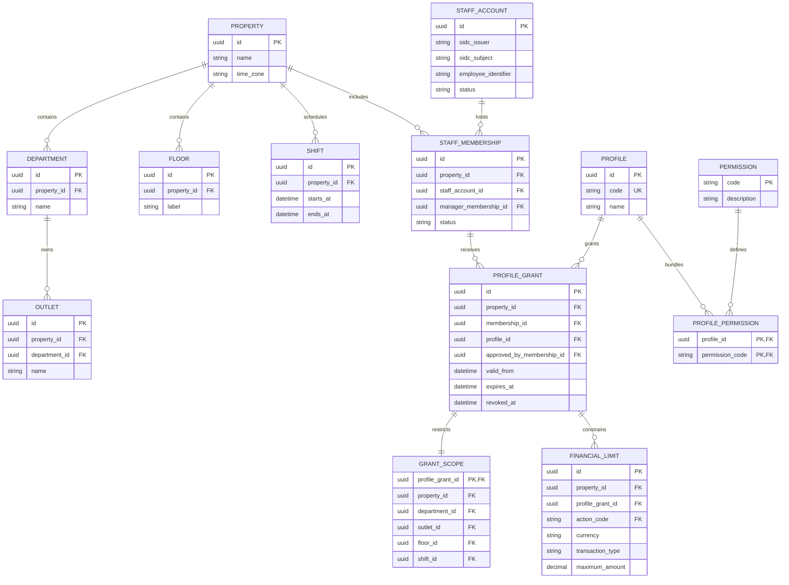
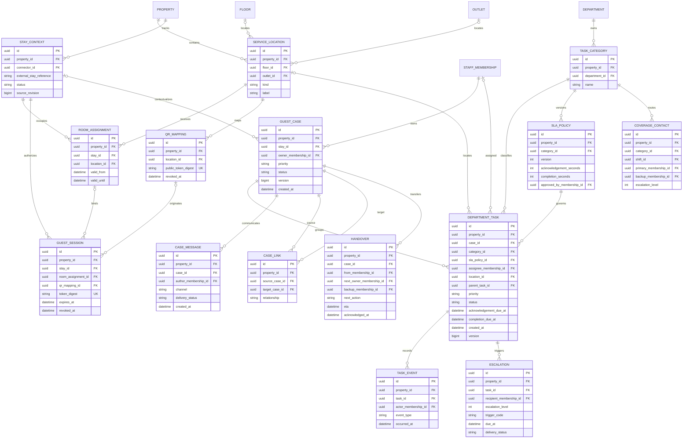
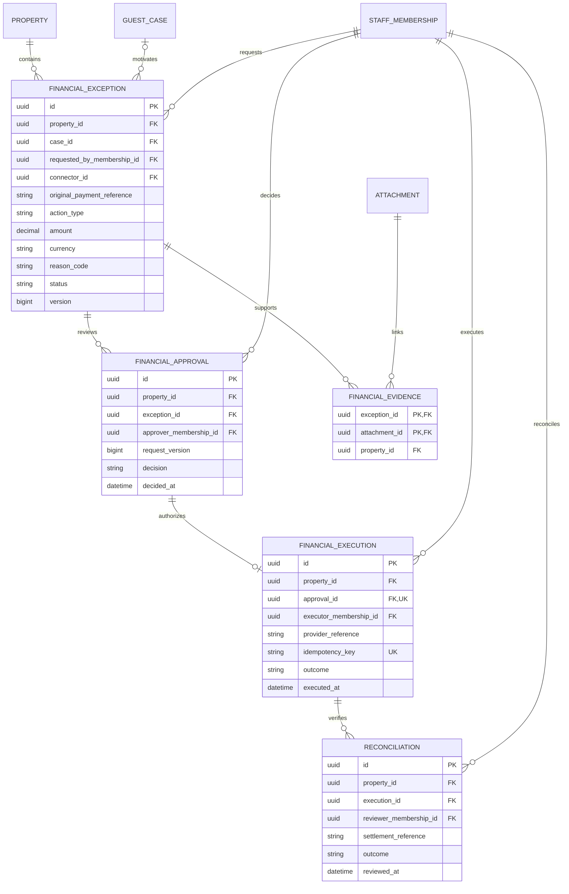
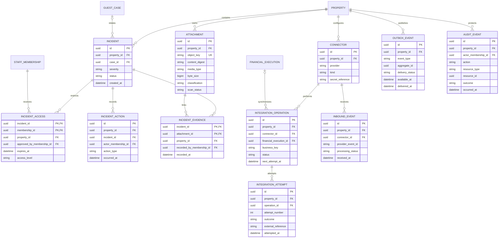

# Proposed Entity Relationship Model

Status: Proposed logical-to-relational design, not an applied schema | Updated: 2026-10-20

## Reading the model

The four Mermaid ER diagrams divide one model into readable domains. Repeated entity names represent the same table. `||` means exactly one, `o|` means zero or one, and `o{` means zero or many. PK/FK/UK identify primary, foreign and unique keys. Attributes are a minimum implementation guide; omitted fields must not be inferred to be forbidden. Nullable references are explicitly described below.

Use UUID primary keys, `timestamptz` event timestamps and UTC storage; property time zones determine display and scheduling. Property-owned records carry `property_id`. Enforce same-property relationships with composite uniqueness and foreign keys, not UUID uniqueness alone. External identifiers are scoped to connector/property, never assumed globally unique.

These diagrams propose data storage needed for [PRD.md](PRD.md), not new business entitlements. See [IMPLEMENTATION_GUIDE.md](IMPLEMENTATION_GUIDE.md) for transactions and migrations.

## 1. Organization, identity and scoped access

Scope has a mandatory property and optional department/outlet/floor/shift, interpreted as a conjunction within that grant. Null means unrestricted within its already-approved parent scope, not unrestricted across properties. Represent disjoint scopes as separate grants. An outlet's department must agree with the grant; constrain `outlet_id` to require its matching `department_id`. Shift eligibility requires current time inside the configured shift plus applicable grant validity.

`manager_membership_id` is optional and references the same property's membership. Approving membership is mandatory for operational grants; initial administrative bootstrap uses a separately recorded, reviewed provisioning procedure. Define unique `(oidc_issuer, oidc_subject)` and `(staff_account_id, property_id)`. Financial limits reference the permission catalog and cannot create an action absent from the profile. Reason/evidence policy remains approved configuration, not an inferred permission.

## 2. Guest context, cases, tasks and shift continuity

Cases can exist without a reservation/stay; tasks may be unassigned. Location floor/outlet links are optional according to room/table kind. A guest session always belongs to a verified stay; room binding is optional only for approved non-room contexts. Enforce that any room assignment matches the session stay, any QR mapping agrees with its authorized location, and revocation applies to the affected session/stay lifecycle.

`parent_task_id` is optional for departmental subtasks; parent and child must share a property and case, and cycles are forbidden. `CASE_LINK` records duplicate/related cases without deleting or retiming either case; reject self-links. `TASK_EVENT` preserves assignment, inspection, reopening and progress changes. System events may have a null actor with an explicit system origin in event metadata. Message author is nullable only for authenticated inbound/system messages with recorded source. Add restricted body/metadata fields during schema implementation with clear data classification.

Task creation binds an immutable approved SLA version and stores computed due times. Subsequent policy changes do not silently alter existing tasks. Coverage contacts include approved primary/backup recipients by shift and escalation level; add approved per-level deadline configuration to policy implementation. Escalation records need a uniqueness key such as `(property_id, task_id, trigger_code, escalation_level, due_at)`; retries update delivery attempts rather than create new logical escalations.

## 3. Financial exception control

Use PostgreSQL exact `numeric`, not floating point, for amounts. Define currency precision and accepted values with Finance. Approval binds a request version covering action, amount, currency, property, original reference and evidence. Only an approved, current version may produce an execution. Rejection/history can create several approval records, but competing active approvals/executions for the same action must be prevented transactionally. One logical execution has many connector attempts in domain 4; retrying does not create a second refund.

Self-approval and reconciliation independence are cross-record/domain rules enforced transactionally against the approved policy. Do not encode every profile combination as a database role. Evidence links must match the exception's property and access class. Provider references may be absent until an outcome is known; unresolved outcomes remain explicit. This is an exception-control model, not a replacement accounting ledger or card-data store.

## 4. Restricted evidence, connectors and durable processing

Incident access is an additional explicit record-level gate alongside profile/scope checks; it does not grant unrelated operational rights. Initial authorized responders must receive access through approved routing. Model detailed evidence custody transfers as additional incident actions and protected audit records; production evidence procedures still require Security approval.

Financial execution is optional on an integration operation because PMS, notifications and other integrations also use this mechanism. Unique `(connector_id, business_key)`, `(connector_id, provider_event_id)` and `(operation_id, attempt_number)` prevent local duplicates. Store secrets in a secret manager; `secret_reference` is a locator only. Outbox and audit targets are typed logical references, not FKs to every table; validate target/type at write time and retain identifiers after archival. Add minimal payload, schema version, correlation and processing-lease fields when implementing the outbox. Ordinary case/task attachments use dedicated `CASE_ATTACHMENT`/`TASK_ATTACHMENT` join tables with the same scoped attachment checks as evidence links.

## Relational constraints and indexes

- Every property-owned parent offers unique `(property_id, id)`; child foreign keys include `property_id`. Add narrower composite keys where category/department, stay/assignment or parent-task/case consistency requires them.
- Declare required FKs non-null; only references explicitly described as optional are nullable. Use restrictive deletion for financial, audit and evidence history; account deactivation is not cascading deletion.
- Add uniqueness for profile codes, membership pairs, provider identities, SLA category/version, connector references and duplicate keys described above. Use check constraints for positive amounts, valid temporal ranges and non-negative targets.
- Index task queues by `(property_id, status, completion_due_at)` and `(property_id, assignee_membership_id, status)`; index active grants by membership, and timeline rows by parent/time. Add category/department queue indexes after representative query plans are measured.
- Use optimistic versions for interactive mutable records and transactional row locks/conditional updates for financial state. Index unsent outbox/due-operation rows, and verify scans remain efficient at the approved workload.
- SQL checks cannot enforce all cross-row authorization/state rules. Implement those in shared transactional domain services, backed by integration tests against real PostgreSQL.
