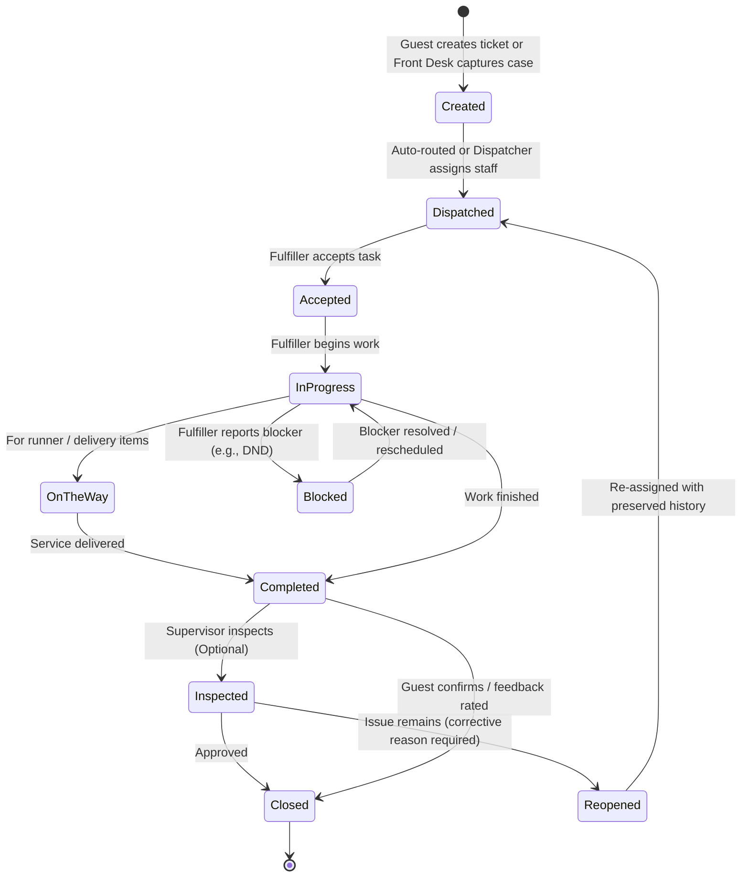
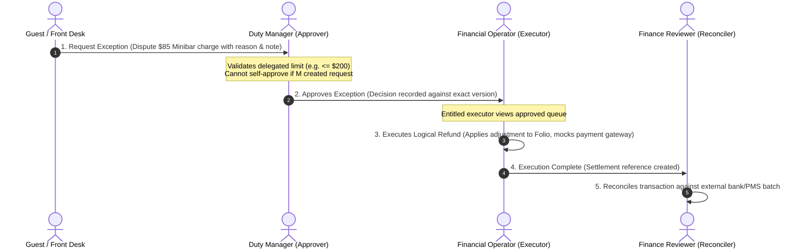

# FRONTEND_FEATURE_MAP.md — Feature & Workflow Mapping

## 1. Overview & Architectural Role
This document maps all approved features, user journeys, and operational workflows from the 13 project workflow diagrams and [PRD.md](PRD.md) into concrete frontend pages, components, role permissions, and simulated event handlers.

Because this is a **frontend-only prototype sprint** (36 hours, limited connectivity), all live APIs, databases, OIDC auth, and payment gateways are replaced with an **in-memory reactive mock store** synchronized with `localStorage`.

---

## 2. High-Level System Partitioning

The application is divided into three distinct user surfaces plus a global simulation controller:

```text
┌─────────────────────────────────────────────────────────────────────────────────┐
│                       GLOBAL DEMO & ROLE SWITCHER BAR                           │
│  [Guest View] [Task Fulfiller] [Dispatcher] [Supervisor] [Front Desk]          │
│  [Duty Manager] [Finance] [Security] [GM / Executive] [Admin] | [Reset Data]    │
└───────────────────────────────────────┬─────────────────────────────────────────┘
                                        │
     ┌──────────────────────────────────┼──────────────────────────────────┐
     ▼                                  ▼                                  ▼
┌───────────────────────┐   ┌───────────────────────┐   ┌────────────────────────┐
│ 1. PUBLIC WEBSITE     │   │ 2. GUEST QR PORTAL    │   │ 3. STAFF DASHBOARDS    │
│ - Hotel Showcase      │   │ - Room Service (F&B)  │   │ - 9 Scoped Role Views  │
│ - Room Booking Engine │   │ - Housekeeping Req.   │   │ - Case Coordination    │
│ - Dining Reservations │   │ - Maintenance Tickets │   │ - Department Queues    │
│ - Spa & Experiences   │   │ - Digital Folio       │   │ - SLA Escalations      │
│ - Simulated Payment   │   │ - Express Checkout    │   │ - Financial Approvals  │
└───────────────────────┘   └───────────────────────┘   └────────────────────────┘
```

---

## 3. Surface 1: Public Hotel Website & Booking Flow
*Reference Diagram: `Client journey website to post-stay.png`*

| Route | Page / Feature | Key Components | User Actions & Simulated Handlers | Permissions / Access |
|---|---|---|---|---|
| `/` | Hotel Homepage | `HeroBanner`, `FeaturedRooms`, `AmenitiesGrid`, `DiningShowcase`, `ReviewsCarousel` | Discover hotel, explore offerings, select dates & guest count | Public (No auth required) |
| `/rooms` | Rooms & Suites | `RoomFilter`, `RoomCard`, `RoomDetailModal`, `AmenityBadges` | Filter by room tier (Deluxe, Suite, Penthouse), view specs and pricing | Public |
| `/book` | Booking Engine & Reservation Flow | `DateRangePicker`, `RoomSelector`, `AddonSelector` (Breakfast, Spa, Airport Transfer), `PriceSummaryCard`, `SimulatedPaymentForm` | Step 1: Select room & rate plan<br>Step 2: Choose extras<br>Step 3: Enter guest details<br>Step 4: Mock payment processing $\rightarrow$ Generate PMS Stay Confirmation | Public |
| `/dining` | Dining & Restaurant | `RestaurantHero`, `MenuViewer`, `TableBookingModal` | Browse dining options, reserve table slot | Public |
| `/spa` | Spa & Recreation Showcase | `ServiceCatalog`, `TherapistRoster`, `BookingEnquiryForm` | Browse wellness treatments, submit appointment request | Public |
| `/contact` | Contact & Inquiries | `ContactForm`, `LocationMap`, `FAQAccordion` | Submit general inquiries $\rightarrow$ routes to Front Desk Queue | Public |

---

## 4. Surface 2: In-Room Simulated Guest QR Portal
*Reference Diagrams: `How a request flows in the app.png`, `Billing, folio, and express checkout.png`, `Housekeeping and amenities.png`, `Food and beverage  room service.png`, `Spa and recreation.png`*

Accessed via simulated room QR code URL: `/guest/portal?room=402&token=demo-token`

| Tab / Sub-route | Feature | Key Components | Simulated Workflow & Lifecycle Linkage |
|---|---|---|---|
| `/guest/portal` (Overview) | In-Room Welcome Hub | `GuestWelcomeCard` (Guest name, room number, checkout date), `QuickActionGrid`, `ActiveRequestsTracker` | Reads verified room session from mock store. Displays real-time status of active tickets. |
| **Room Service (F&B)** | Digital Room Dining & KDS Integration | `CategoryTabs`, `MenuItemCard`, `CustomizationModal` (dietary, spice), `CartDrawer`, `OrderConfirmationModal` | 1. Guest places order $\rightarrow$ Order sent to F&B/KDS Queue.<br>2. Status updates: *Received* $\rightarrow$ *Preparing* $\rightarrow$ *Ready for Collection* $\rightarrow$ *On the Way* $\rightarrow$ *Delivered*.<br>3. Charges automatically appended to room Folio. |
| **Housekeeping** | Amenities & Cleaning Requests | `AmenityCatalog` (Towels, Toiletries, Pillows, Water), `RoomCleaningScheduler`, `DNDToggle` | 1. Guest selects items or cleaning window.<br>2. Evaluates "Guest permits room entry" (Yes / No / DND).<br>3. Task dispatched to Housekeeping Queue.<br>4. Guest gets notification on completion $\rightarrow$ feedback rating. |
| **Maintenance** | Issue Reporting & Triage | `IssueCategorySelector` (AC, Plumbing, Electrical, TV), `PhotoUploadMock`, `UrgencySelector`, `TicketTimeline` | 1. Guest logs ticket $\rightarrow$ Front Desk & Engineering Queue.<br>2. Severity triage (Minor vs Urgent vs Safety/Security).<br>3. Urgent/Safety routes immediate alert to Duty Manager. |
| **Spa & Wellness** | Wellness Treatment Booking | `TreatmentList`, `TimeSlotPicker`, `TherapistPreference`, `ChargeToRoomToggle` | 1. Checks available live slots.<br>2. Guest confirms with cancellation policy agreement.<br>3. Booking placed in Spa Queue; charge posted to folio. |
| **Folio & Express Checkout** | Digital Folio & Departure | `FolioItemList`, `DisputeChargeModal`, `PaymentSettlementCard`, `DigitalSignaturePad`, `CheckoutSuccessModal` | 1. View itemized charges (room rate, F&B, spa, taxes).<br>2. **Dispute item**: guest flags incorrect charge $\rightarrow$ triggers Front Desk/Finance dispute case.<br>3. **Express Checkout**: guest reviews, confirms balance, signs.<br>4. **Lifecycle revocation**: Marks reservation *Checked Out*, revokes QR token, signals Housekeeping for vacant room turnover. |

---

## 5. Surface 3: Staff Dashboards & The 9 Approved Roles
*Reference Documents: [PRD.md](PRD.md), [DESIGN.md](DESIGN.md), [SECURITY.md](SECURITY.md), and Role Workflow Diagrams*

### 1. Task Fulfiller (Attendant, Runner, Technician)
- **Role Code**: `task_fulfiller`
- **Intended Views**: `/staff/fulfiller` (Mobile-optimized "My Tasks")
- **Permissions**:
  - View only essential assigned tasks in scoped department/floor.
  - State transitions: `Accept` $\rightarrow$ `In Progress` $\rightarrow$ `On the Way` (for runners/delivery) $\rightarrow$ `Completed`.
  - Report `Blocked` (requires mandatory reason text, e.g., "Guest DND", "Awaiting parts").
  - Add operational completion notes and attachments.
- **Strict Boundaries**: Cannot reassign colleagues, cannot view full folios, cannot view unrelated guest PII or security incident evidence, cannot release unsafe rooms.

### 2. Department Dispatcher
- **Role Code**: `department_dispatcher`
- **Intended Views**: `/staff/dispatcher` (Department Queue & Staff Workload)
- **Permissions**:
  - View scoped incoming unassigned and active work for department (Housekeeping, F&B, Maintenance, etc.).
  - View staff availability and active workloads.
  - Categorize, schedule, and assign eligible staff within scope.
  - Link duplicate tasks/cases (preserves original timestamps and SLA targets).
  - Monitor overdue indicators and trigger manual department escalation.
- **Strict Boundaries**: Cannot issue compensation, price overrides, or hide delays.

### 3. Department Supervisor
- **Role Code**: `department_supervisor`
- **Intended Views**: `/staff/supervisor` (Supervision, QA & Handover)
- **Permissions**:
  - Reassign tasks across department staff; arrange shift backups.
  - Inspect completed tasks; reopen incomplete work with mandatory recorded corrective action.
  - Shift Handover Management: Record unresolved obligations, assign next owner, set expected ETA, and designate backup responder.
- **Strict Boundaries**: Cannot release rooms marked unsafe by Engineering; cannot perform unrestricted financial refunds.

### 4. Department Manager / Duty Manager
- **Reference Diagram**: `Duty Manager and escalations.png`
- **Role Code**: `department_manager`
- **Intended Views**: `/staff/duty-manager` (Escalations & Service Recovery)
- **Permissions**:
  - Receive automated SLA breach alerts, VIP guest cases, and cross-department escalations.
  - Coordinate multi-team incident resolution (e.g. urgent AC failure requiring room move).
  - Approve service recovery compensation up to delegated limit (e.g., up to $200 credit or amenity voucher).
  - Escalate unresolved beyond-authority issues to GM / Operations Head.
- **Strict Boundaries**: Cannot bypass emergency security protocols; cannot delete incident or audit logs.

### 5. Front Desk Coordinator
- **Reference Diagram**: `Front Desk and concierge.png`, `Billing, folio, and express checkout.png`
- **Role Code**: `front_desk_coordinator`
- **Intended Views**: `/staff/front-desk` (PMS Front Desk, Cases, Stays & Folios)
- **Permissions**:
  - View & manage guest arrivals, departures, room assignments, and reservations.
  - Capture incoming guest cases (phone, walk-in, concierge requests); auto-route or dispatch to departments.
  - Initiate room moves (updates stay context and triggers session revocation for old room).
  - Handle checkout exceptions, minibar adjustments, and initial folio dispute intake.
  - Maintain direct guest communication timeline.
- **Strict Boundaries**: Financial operations subject to delegated limits; sensitive self-approval prohibited.

### 6. Financial Operator
- **Reference Diagram**: `Billing, folio, and express checkout.png`
- **Role Code**: `financial_operator`
- **Intended Views**: `/staff/finance` (Financial Exceptions, Folio Adjustments & Reconciliation)
- **Permissions**:
  - Review dispute cases submitted by Front Desk or Guest Portal.
  - View approved financial exception requests with attached evidence.
  - Execute logical corrections/refunds against approved request versions.
  - Perform independent financial reconciliation against provider/POS references.
- **Strict Boundaries**:
  - **Separation of Duties (REQ-08)**: Cannot approve exceptions they requested.
  - No access to raw card numbers (only masked references).
  - Cannot alter approved exception amounts during execution.

### 7. Security Responder
- **Reference Diagrams**: `Role hierarchy and escalation.png`, `Maintenance and technical support.png`
- **Role Code**: `security_responder`
- **Intended Views**: `/staff/security` (Emergency Incidents & Evidence)
- **Permissions**:
  - Immediate alert notifications for safety emergencies, panic alarms, or severe hazards.
  - Acknowledge alert, record on-scene arrival, and request backup.
  - Log restricted incident actions, notes, and evidence attachments.
- **Strict Boundaries**:
  - Ordinary staff and managers cannot view restricted security incident details.
  - Security responder cannot access general hotel folios, billing records, or delete evidence.

### 8. Executive Viewer / Approver (GM & Operations Head)
- **Reference Diagram**: `GM  Operations Head workflow.png`
- **Role Code**: `executive_viewer`
- **Intended Views**: `/staff/executive` (Executive KPIs & High-Level Approvals)
- **Permissions**:
  - Comprehensive high-level KPI dashboard: Overall SLA compliance %, department response times, guest satisfaction ratings, recurring maintenance trends.
  - High-tier approval authority: Approve financial compensation beyond manager limits (e.g. >$200); approve policy changes.
  - Review cross-department escalation trends.
- **Strict Boundaries**: Title grants no automatic platform administration, raw payment credentials, or safety overrides.

### 9. Platform Administrator
- **Reference Diagram**: `Admin and IT workflow.png`
- **Role Code**: `platform_admin`
- **Intended Views**: `/staff/admin` (System Administration & Mappings)
- **Permissions**:
  - User account management: assign/revoke profile grants, departments, outlets, and shifts.
  - Room & QR Code Management: Map physical rooms/locations to unique QR tokens and generate demo QR links.
  - Service catalog, SLA targets, and routing configuration.
  - Integration health dashboard (simulate PMS/POS/Payment connection drops and retry behaviors).
  - View immutable system audit logs.
- **Strict Boundaries**: No financial transaction authority; cannot bypass least privilege; no self-elevation without audit trail.

---

## 6. End-to-End Workflow & State Machine Mapping

### Workflow A: Operational Request to Resolution
*Triggered from: Guest QR Portal OR Front Desk intake*



### Workflow B: SLA Escalation Engine
*Simulated timer running in frontend mock store*

1. **Task Created**: Sets `acknowledgement_due_at` (e.g., +5m) and `completion_due_at` (e.g., +20m).
2. **Timer Ticks**:
   - If not acknowledged within 5m $\rightarrow$ Warning badge turned amber; notification to Dispatcher.
   - If not completed within deadline $\rightarrow$ Escalates to Level 1 (Department Supervisor).
   - If overdue + repeat failure or VIP tag $\rightarrow$ Escalates to Level 2 (Duty Manager).
   - If unresolved critical case $\rightarrow$ Escalates to Level 3 (GM / Operations Head).
3. **Invariants**: Reassigning or linking duplicate cases **never** resets original creation timestamps.

### Workflow C: Dispute to Financial Reconciliation
*Triggered from: Guest Portal folio dispute OR Front Desk billing question*



---

## 7. Flagged Inconsistencies & Clarifications

| Topic | Existing Document Mention | Frontend Prototype Resolution |
|---|---|---|
| **Backend & Database** | `TECH_STACK.md` and `IMPLEMENTATION_GUIDE.md` specify PostgreSQL, Drizzle, BullMQ, Redis, OIDC Keycloak. | **Flagged**: User explicitly constrained this sprint to a **frontend-only prototype** with no backend or live databases. Solved by replacing server persistence with a typed, reactive in-browser Mock Store (`localStorage`). |
| **Package Manager** | `IMPLEMENTATION_GUIDE.md` suggests `pnpm workspace`. | **Flagged**: Host environment has `node v24.16.0` and `npm v11.13.0`; `pnpm` is not installed. Use `npm` to ensure zero setup friction. |
| **Pending Business Policies** | `DECISIONS.md` lists P-04 (SLA targets), P-05 (escalation times), P-06 (financial limits) as pending approval. | **Resolved for Prototype**: Provide realistic defaults (e.g., 5 min ack, 20 min completion; $200 Manager limit, $1000 GM limit) with in-UI badges indicating "Prototype Default — Configurable via Admin". |
| **Guest Authentication** | `PRD.md` notes guest login design is pending; QR mapping is required. | **Resolved for Prototype**: Guest access simulated via room-specific URL tokens (`/guest/portal?room=402&token=xyz`) matching `QR_MAPPING` from [ER_DIAGRAMS.md](ER_DIAGRAMS.md). |
| **Role Titles vs 9 Profiles** | Workflow diagrams use titles (e.g. "Housekeeping Attendant", "Engineering Technician", "Duty Manager"), while PRD defines 9 profiles. | **Aligned**: The 9 architectural profiles act as the underlying RBAC permission bundles, while UI personas represent realistic department roles mapped to these profiles. |

---

## 8. Verified Feature IDs & Cross-Role Traceability Matrix

*Verified against `Tech_Team_Project_Guide_and_Feature_Spec.pdf` and Sprint Backlog.*

| Feature ID | Exact Source Name | Relevant Screens | Shared Roles / Surfaces | Status | Connected Workflow Summary |
|---|---|---|---|---|---|
| **F01** | Stay-Linked QR Login & Verification | `/guest/portal?room=...&token=...` | Guest, Front Desk, Platform Admin | **Implemented** | Binds QR token to verified in-house stay. Invalidated on checkout or room move. |
| **F02** | Unified Stay Dashboard | `/guest/portal` (Home) | Guest | **Implemented** | 390px mobile-first stay view, shortcuts to housekeeping, dining, maintenance, live orders, folio. |
| **F04** | Digital DND Conflict Guard | Front Desk (`/staff/front-desk`), Guest Portal, Housekeeping | Guest, Front Desk, Task Fulfiller | **Implemented** | Guest sets DND; prevents housekeeping dispatch conflicts; flags DND badge in Front Desk rooms grid. |
| **F05** | Multi-Language & Accessible WCAG UI | All screens (`/hotel`, `/guest/portal`, `/staff/*`) | All Personas | **Implemented** | High-contrast tokens, accessible focus rings, aria labels, pastel light / deep navy dark theme switch. |
| **F08** | Pre-Arrival Check-in Link & ID Verification | `/hotel` (Manage Booking), `/staff/front-desk` (Stays tab) | Guest, Front Desk Coordinator | **Implemented** | Guest selects estimated arrival time & accepts registration; Front Desk arrivals shows `pending_verify`; Front Desk staff verifies ID upon physical arrival. |
| **F09** | Paid Early Check-in & Late Checkout | `/hotel` (Manage Booking), `/staff/front-desk` (Stays tab) | Guest, Front Desk Coordinator | **Implemented** | Guest requests same-day early check-in ($40 fee); Front Desk decides based on live room readiness (`ready` & vacant); fee posted to folio. |
| **F12** | Room Discovery, Floor Explorer & Online Booking Engine | `/hotel` (Hero, Catalog, Explorer, Booking Wizard) | Public Guest, Front Desk Coordinator | **Implemented** | 27 rooms across 5 floors, interactive floor map, side-by-side comparison, date validation, transparent pricing, simulated card payment, creates Front Desk arrival stay. |
| **F14** | Payment-PMS Sync Reconciliation | `/hotel` (Booking Wizard), `/staff/front-desk` (Reconcile tab), `/staff/finance` | Public Guest, Front Desk Coordinator, Financial Operator | **Implemented** | Fix 1: When PMS integration is down/degraded, booking payment is captured but held as `pending_confirmation` and creates `SyncIssue` in Front Desk Reconcile tab; Front Desk can retry sync, manually confirm (audited), or request refund to Finance queue. Guest sees real-time status. |
| **F21** | Room Readiness Board (Dirty $\rightarrow$ Cleaning $\rightarrow$ Ready) | `/staff/front-desk` (Rooms tab), `/hotel` (Explorer & Catalog) | Front Desk Coordinator, Housekeeping Attendant, Supervisor | **Implemented** | Separates occupancy from cleanliness. Public website room search and early check-in only offer rooms that are verified ready in shared state. |
| **F27** | Out of Order (OOO) Room Block Approval | `/staff/front-desk` (Rooms tab), `/staff/duty-manager` | Front Desk Coordinator, Duty Manager | **Implemented** | Front Desk requests room block; Duty Manager approves; room marked out of order; public explorer immediately shows room as under maintenance / unbookable. |
| **F28 / F29** | Live Menu, Room Service Ordering & Delivery Tracking | `/guest/portal` (Dining tab), `/hotel` (Dining section) | Guest, Food & Beverage Runner, Dispatcher | **Implemented** | Live menu categories, cart, 5-step delivery tracker with ETA, charge posted to room folio. |
| **F32** | Service Recovery Cases & Comps | `/staff/front-desk` (Complaints tab), `/staff/duty-manager` | Front Desk Coordinator, Duty Manager | **Implemented** | Front Desk captures complaint, proposes compensation up to $50 limit; Duty Manager approves higher comps. |
| **F34** | Digital Checkout Checklist, Disputes & Session Revocation | `/guest/portal` (Folio tab), `/staff/front-desk` (Stays tab) | Guest, Front Desk Coordinator, Financial Operator | **Implemented** | Verifies $0 balance & 0 open dispute items; executes checkout; immediately revokes QR session and dispatches turnover task to Housekeeping. |

